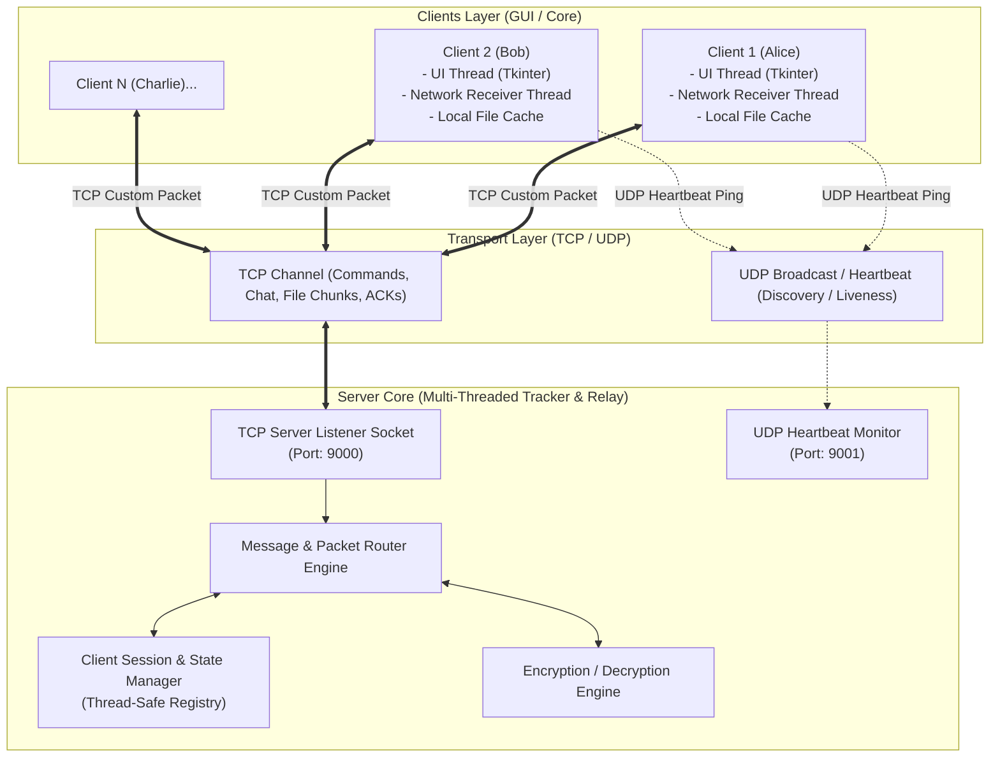

# KẾ HOẠCH CHI TIẾT XÂY DỰNG HỆ THỐNG COLLABORATION CLIENT-SERVER PHÂN TÁN
> **Môn học:** Network Application Development  
> **Dự án:** Distributed Client-Server Collaboration Application  
> **Mục tiêu:** Xây dựng từ đầu (from scratch) bằng Raw Socket, đạt điểm tối đa (10/10) và chuẩn bị sẵn sàng cho phần vấn đáp bảo vệ đồ án (Oral Defense).

---

## 📌 MỤC LỤC
1. [Tổng Quan Đề Bài & Các Ràng Buộc Kỹ Thuật Bắt Buộc](#1-tổng-quan-đề-bài--các-ràng-buộc-kỹ-thuật-bắt-buộc)
2. [Bảng Đối Chiếu 10 Thang Điểm Rubric & Các Giai Đoạn](#2-bảng-đối-chiếu-10-thang-điểm-rubric--các-giai-đoạn)
3. [Kiến Trúc Hệ Thống & Cấu Trúc Thư Mục Dự Án](#3-kiến-trúc-hệ-thống--cấu-trúc-thư-mục-dự-án)
4. [Lộ Trình Xây Dựng Chi Tiết (Từng Micro-Step Nhỏ)](#4-lộ-trình-xây-dựng-chi-tiết-từng-micro-step-nhỏ)
   - [Giai đoạn 0: Khởi tạo môi trường, Cấu trúc dự án & Git Workflow](#giai-đoạn-0-khởi-tạo-môi-trường-cấu-trúc-dự-án--git-workflow)
   - [Giai đoạn 1: Thiết kế Giao thức Tầng Ứng Dụng (Application Layer Protocol) (1 pt)](#giai-đoạn-1-thiết-kế-giao-thức-tầng-ứng-dụng-application-layer-protocol-1-pt)
   - [Giai đoạn 2: Cơ chế Bắt tay Cơ bản Client-Server qua TCP (1 pt)](#giai-đoạn-2-cơ-chế-bắt-tay-cơ-bản-client-server-qua-tcp-1-pt)
   - [Giai đoạn 3: Xử lý Đa nhiệm & Đa kết nối Đồng thời (Concurrency) (1 pt)](#giai-đoạn-3-xử-lý-đa-nhiệm--đa-kết-nối-đồng-thời-concurrency-1-pt)
   - [Giai đoạn 4: Xác thực & Quản lý Trạng thái Người dùng (Auth & State Management) (1 pt)](#giai-đoạn-4-xác-thực--quản-lý-trạng-thái-người-dùng-auth--state-management-1-pt)
   - [Giai đoạn 5: Định tuyến Tin nhắn Thời gian thực (Broadcast & Private Messaging) (1 pt)](#giai-đoạn-5-định-tuyến-tin-nhắn-thời-gian-thực-broadcast--private-messaging-1-pt)
   - [Giai đoạn 6: Truyền File Tin Cậy qua TCP (Reliable File Transfer) (1 pt)](#giai-đoạn-6-truyền-file-tin-cậy-qua-tcp-reliable-file-transfer-1-pt)
   - [Giai đoạn 7: Khả năng Chịu lỗi, Heartbeat & Xử lý Ngắt kết nối (Network Resilience) (1 pt)](#giai-đoạn-7-khả-năng-chịu-lỗi-heartbeat--xử-lý-ngắt-kết-nối-network-resilience-1-pt)
   - [Giai đoạn 8: Lớp Bảo mật & Mã hóa Dữ liệu (Security Layer - AES/Cryptography) (1 pt)](#giai-đoạn-8-lớp-bảo-mật--mã-hóa-dữ-liệu-security-layer---aescryptography-1-pt)
   - [Giai đoạn 9: Tích hợp Giao diện Người dùng Đầy đủ (Intuitive GUI Integration) (1 pt)](#giai-đoạn-9-tích-hợp-giao-diện-người-dùng-đầy-đủ-intuitive-gui-integration-1-pt)
   - [Giai đoạn 10: Kiểm thử Toàn diện, Tối ưu Hiệu năng & Hoàn thiện Code (1 pt)](#giai-đoạn-10-kiểm-thử-toàn-diện-tối-ưu-hiệu-năng--hoàn-thiện-code-1-pt)
   - [Giai đoạn 11: Hoàn thiện Báo cáo Kỹ thuật (Technical Report PDF) & Ôn tập Vấn đáp](#giai-đoạn-11-hoàn-thiện-báo-cáo-kỹ-thuật-technical-report-pdf--ôn-tập-vấn-đáp)
5. [Quy Trình Học Tập Từng Bước Cùng AI (Pair-Programming Rules)](#5-quy-trình-học-tập-từng-bước-cùng-ai-pair-programming-rules)

---

## 1. TỔNG QUAN ĐỀ BÀI & CÁC RÀNG BUỘC KỸ THUẬT BẮT BUỘC

### 1.1. Mục tiêu cốt lõi
Xây dựng một hệ thống phân tán Client-Server cho phép các máy tính trong mạng nội bộ (LAN / VPN / localhost):
1. **Xác thực và phát hiện người dùng (User Authentication & Active User Discovery):** Đăng nhập, cập nhật danh sách người dùng đang online theo thời gian thực.
2. **Nhắn tin thời gian thực (Real-time Messaging):** Hỗ trợ chat nhóm chung (Broadcast) và chat riêng tư giữa 2 người (Unicast/Private Direct Message).
3. **Truyền file tin cậy (Reliable File Transfer):** Gửi/nhận file mọi định dạng và kích thước, không bị hỏng dữ liệu (data corruption), có thanh tiến trình (progress bar).
4. **Khả năng chịu lỗi cao (Connection Resilience):** Xử lý mượt mà khi client mất mạng đột ngột, timeout, tự động dọn dẹp kết nối, duy trì nhịp tim (Heartbeat/Keepalive).
5. **Bảo mật dữ liệu (Secure Transmission):** Mã hóa payload để chống việc bắt trộm gói tin (sniffing/Wireshark).

### 1.2. Ràng buộc kỹ thuật nghiêm ngặt (Strict Constraints)
- **CẤM TUYỆT ĐỐI** sử dụng các thư viện mạng bậc cao như HTTP frameworks (`Flask`, `Django`, `FastAPI`), WebSockets (`websockets`, `socket.io`), hoặc thư viện RPC có sẵn.
- **BẮT BUỘC** lập trình trên socket tầng thấp (Raw Socket: module `socket` trong Python).
- **Tự thiết kế giao thức tầng ứng dụng (Custom Application-Layer Protocol):** Tự định nghĩa Header, Payload, End-of-Message / Length Framing, Message Types.
- **Khả năng phục vụ:** Server phải xử lý đồng thời tối thiểu **10 - 20 clients** một lúc mà không bị treo/đơ (Multi-threading / Threading).
- **Chính sách liêm chính học thuật (Academic Integrity):**
  - Mọi commit phải được đẩy lên GitHub/GitLab liên tục trong suốt quá trình làm bài.
  - Sinh viên **phải hiểu và giải thích được 100% dòng code** khi vấn đáp bảo vệ (Oral Defense). Không giải thích được code do AI sinh ra sẽ nhận 0 điểm.

---

## 2. BẢNG ĐỐI CHIẾU 10 THANG ĐIỂM RUBRIC & CÁC GIAI ĐOẠN

| Bước Rubric | Tiêu chí đánh giá của Giảng viên | Điểm | Giai đoạn tương ứng trong Kế hoạch |
| :---: | :--- | :---: | :--- |
| **Step 1** | **Setup & Protocol Design:** Định nghĩa cấu trúc packet, các loại message (AUTH, MSG, FILE), state diagrams trước khi code. | 1.0 pt | **Giai đoạn 1** |
| **Step 2** | **Basic Client-Server Handshake:** Kết nối socket TCP cơ bản, gửi và nhận ACK xác nhận. | 1.0 pt | **Giai đoạn 2** |
| **Step 3** | **Concurrency Implementation:** Áp dụng Multi-threading để Server phục vụ nhiều Client cùng lúc không bị block. | 1.0 pt | **Giai đoạn 3** |
| **Step 4** | **Authentication & State Management:** Cơ chế đăng nhập, quản lý bảng phiên (Username, IP, Port, Active Clients). | 1.0 pt | **Giai đoạn 4** |
| **Step 5** | **Real-Time Text Routing:** Định tuyến tin nhắn: Broadcast (chat phòng chung) và Unicast (chat riêng 1-1). | 1.0 pt | **Giai đoạn 5** |
| **Step 6** | **Reliable File Transfer:** Cắt file thành các chunk, truyền qua TCP, ghép lại nguyên vẹn, kiểm tra checksum SHA-256. | 1.0 pt | **Giai đoạn 6** |
| **Step 7** | **Network Resilience & Error Handling:** Bắt các ngoại lệ socket timeouts, broken pipes, graceful shutdown, heartbeat. | 1.0 pt | **Giai đoạn 7** |
| **Step 8** | **Security Layer:** Mã hóa payload bằng thư viện mật mã chuẩn (AES / Cryptography) trước khi gửi qua mạng. | 1.0 pt | **Giai đoạn 8** |
| **Step 9** | **UI/CLI Integration:** Giao diện trực quan hiển thị danh sách online, khung chat, thanh tiến trình file (Progress bar). | 1.0 pt | **Giai đoạn 9** |
| **Step 10** | **Testing & Code Quality:** Unit test, stress test mô phỏng 10-20 clients, code clean, comment chuẩn PEP 8. | 1.0 pt | **Giai đoạn 10** |
| **Báo cáo** | **Technical Report (PDF):** Kiến trúc hệ thống, Protocol Specs, Sequence Diagrams, Thách thức & Giải pháp. | Bắt buộc | **Giai đoạn 11** |

---

## 3. KIẾN TRÚC HỆ THỐNG & CẤU TRÚC THƯ MỤC DỰ ÁN

### 3.1. Sơ đồ Kiến trúc Tổng thể (Architecture Diagram)


### 3.2. Cấu trúc Thư mục Chuẩn Hóa
```text
DISTRIBUTED-CLIENT-SERVER-COLLABORATION-APPLICATION/
│
├── common/                     # Thư mục mã nguồn dùng chung cho cả Client & Server
│   ├── __init__.py
│   ├── protocol.py             # Định nghĩa cấu trúc Packet, Magic Bytes, Packet Framing (encode/decode)
│   ├── message_types.py        # Enum định nghĩa các mã thông điệp (AUTH, MSG, FILE, HEARTBEAT, ...)
│   ├── crypto_utils.py         # Module mã hóa & giải mã dữ liệu (AES-256-GCM / Fernet)
│   └── logger.py               # Module ghi log chuẩn hóa cho toàn hệ thống
│
├── server/                     # Toàn bộ mã nguồn phía Server
│   ├── __init__.py
│   ├── server_core.py          # Lớp Server chính: Quản lý socket listener, chấp nhận kết nối
│   ├── client_handler.py       # Thread riêng biệt xử lý cho từng Client kết nối tới
│   ├── session_manager.py      # Quản lý danh sách User đang online, IP, Port, thread-safe locks
│   └── router.py               # Điều hướng tin nhắn (Broadcast, Direct Message, File Relay)
│
├── client/                     # Toàn bộ mã nguồn phía Client
│   ├── __init__.py
│   ├── client_core.py          # Lớp Client logic: Kết nối, gửi/nhận packet ở tầng network
│   ├── file_transfer.py        # Logic chia nhỏ file (chunking), kiểm tra SHA-256, ghép file
│   ├── heartbeat.py            # Thread định kỳ gửi UDP/TCP Heartbeat thông báo còn sống
│   └── gui/                    # Giao diện người dùng (Tkinter)
│       ├── __init__.py
│       ├── app.py              # Cửa sổ chính, quản lý các khung chat, user list
│       ├── login_view.py       # Khung đăng nhập (IP, Port, Username)
│       ├── chat_view.py        # Khung chat chung (Global) và chat riêng (Private)
│       └── file_progress.py    # Thanh tiến trình gửi/nhận file (Progress bar popup)
│
├── tests/                      # Thư mục kiểm thử tự động
│   ├── test_protocol.py        # Unit test cho quá trình pack/unpack packet
│   ├── test_crypto.py          # Unit test cho mã hóa/giải mã
│   ├── test_file_transfer.py   # Unit test kiểm tra độ toàn vẹn của file (SHA-256)
│   └── stress_test.py          # Script giả lập 10-20 client kết nối cùng lúc
│
├── docs/                       # Tài liệu báo cáo
│   ├── report_outline.md       # Dàn ý chi tiết cho bản báo cáo PDF
│   ├── protocol_specs.md       # Đặc tả giao thức chi tiết
│   └── diagrams/               # Các sơ đồ thiết kế (Architecture, Sequence, State)
│
├── storage/                    # Thư mục chứa file tải về thử nghiệm
│   ├── server_cache/
│   └── client_downloads/
│
├── run_server.py               # File thực thi khởi động Server
├── run_client.py               # File thực thi khởi động Client
├── requirements.txt            # Danh sách thư viện phụ trợ (cryptography, pytest, v.v.)
├── README.md                   # Hướng dẫn cài đặt và sử dụng phần mềm
└── DEVELOPMENT_PLAN.md         # File kế hoạch chi tiết (file này)
```

---

## 4. LỘ TRÌNH XÂY DỰNG CHI TIẾT (TỪNG MICRO-STEP NHỎ)

---

### GIAI ĐOẠN 0: KHỞI TẠO MÔI TRƯỜNG, CẤU TRÚC DỰ ÁN & GIT WORKFLOW
> **Mục tiêu:** Chuẩn bị nền móng dự án sạch sẽ, tuân thủ tiêu chuẩn kỹ thuật và thiết lập nhật ký commit Git chứng minh quá trình tự làm.

- [x] **Micro-step 0.1: Thiết lập môi trường ảo Python**
  - Khởi tạo virtual environment: `python -m venv venv`.
  - Cấu hình kích hoạt trên Windows PowerShell: `.\venv\Scripts\Activate.ps1`.
- [x] **Micro-step 0.2: Cấu hình `requirements.txt` tối giản**
  - Chỉ cài các thư viện phụ trợ cho mã hóa và kiểm thử (tuyệt đối không cài thư viện web):
    - `cryptography>=42.0.0` (phục vụ mã hóa AES ở Step 8).
    - `pytest>=8.0.0` (phục vụ kiểm thử ở Step 10).
- [x] **Micro-step 0.3: Tạo khung xương thư mục (Scaffolding)**
  - Tạo các thư mục `common/`, `server/`, `client/`, `client/gui/`, `tests/`, `docs/`, `storage/` cùng các file `__init__.py`.
- [x] **Micro-step 0.4: Thiết lập chiến lược Git Commit chuẩn**
  - Commit ban đầu: `feat(init): project scaffolding, directory structure and requirements`.
  - Quy ước mỗi micro-step hoàn thành sẽ tạo 1 Git commit có mô tả rõ ràng để phục vụ chấm điểm tiến độ 6 tuần.

---

### GIAI ĐOẠN 1: THIẾT KẾ GIAO THỨC TẦNG ỨNG DỤNG (APPLICATION LAYER PROTOCOL) (1 PT)
> **Mục tiêu đạt Rubric Step 1:** Thiết kế cấu trúc gói tin (Packet Framing), định nghĩa danh sách các loại Message Type, quy định định dạng Header và Payload, vẽ sơ đồ chuyển trạng thái (State Diagram).

#### 🧠 Kiến thức mạng trọng tâm cần nắm:
- **Hiện tượng TCP Streaming:** TCP là luồng byte liên tục (stream of bytes), không có ranh giới gói tin (packet boundary). Nếu gửi liên tiếp 2 tin nhắn, bên nhận có thể nhận cả 2 trong 1 lần đọc (Packet Concatenation) hoặc nhận từng phần của 1 tin (Packet Fragmentation).
- **Kỹ thuật Packet Framing:** Để giải quyết vấn đề trên, giao thức của chúng ta sẽ sử dụng phương pháp **Header Độ Dài Cố Định (Fixed-length Header)** chứa kích thước của Payload. Bên nhận sẽ luôn đọc đủ Header trước, trích xuất độ dài `N`, sau đó lặp đọc đúng `N` bytes tiếp theo.

#### 🛠️ Các Micro-steps thực hiện:
- [ ] **Micro-step 1.1: Định nghĩa Cấu trúc Packet chuẩn (Fixed Header + Dynamic Payload)**
  - Thiết kế Header nhị phân kích thước cố định **16 bytes**:
    - `Magic Bytes` (2 bytes, vd: `b"CA"` - Collaboration App): Nhận diện gói tin hợp lệ của app.
    - `Version` (1 byte, vd: `1`): Phiên bản giao thức.
    - `Message Type` (2 bytes): Mã loại thông điệp (AUTH, MSG, FILE, v.v.).
    - `Flags` (1 byte): Đánh dấu (vd: `0x01` là nén, `0x02` là đã mã hóa).
    - `Reserved` (2 bytes): Dự phòng mở rộng tương lai.
    - `Payload Length` (8 bytes - 64-bit integer): Kích thước chính xác của payload tính bằng bytes.
- [ ] **Micro-step 1.2: Xây dựng bảng Message Types (`common/message_types.py`)**
  - `AUTH_REQ (101)`, `AUTH_RESP_SUCCESS (102)`, `AUTH_RESP_FAIL (103)`
  - `USER_LIST_REQ (201)`, `USER_LIST_RESP (202)`, `USER_STATUS_BROADCAST (203)`
  - `CHAT_BROADCAST (301)`, `CHAT_DIRECT (302)`, `CHAT_ACK (303)`
  - `FILE_OFFER_REQ (401)`, `FILE_OFFER_RESP (402)`, `FILE_CHUNK (403)`, `FILE_ACK (404)`
  - `HEARTBEAT_PING (501)`, `HEARTBEAT_PONG (502)`
  - `DISCONNECT_NOTICE (601)`
- [ ] **Micro-step 1.3: Hiện thực module Đóng gói & Mở gói (`common/protocol.py`)**
  - Viết hàm `create_packet(msg_type, payload_bytes, is_encrypted=False) -> bytes` dùng `struct.pack("!2sBBHBQ", ...)`.
  - Viết hàm đọc đúng chính xác số bytes từ socket: `recv_exact(sock, length) -> bytes`.
  - Viết hàm `recv_packet(sock) -> (msg_type, payload_bytes, is_encrypted)`:
    - Bước 1: Đọc 16 bytes header bằng `recv_exact`.
    - Bước 2: Parse thông tin header, kiểm tra Magic Bytes.
    - Bước 3: Đọc tiếp `payload_length` bytes bằng `recv_exact`.
- [ ] **Micro-step 1.4: Viết tài liệu Protocol Specification (`docs/protocol_specs.md`)**
  - Mô tả chi tiết từng byte trong Header.
  - Vẽ sơ đồ trạng thái (Client State Machine: `DISCONNECTED` -> `CONNECTING` -> `AUTHENTICATING` -> `ONLINE` -> `TRANSFERRING_FILE` -> `DISCONNECTED`).

#### 🧪 Tiêu chí nghiệm thu (Acceptance Criteria):
- Chạy unit test `tests/test_protocol.py`: Giả lập việc đóng gói chuỗi văn bản bất kỳ hoặc file nhị phân, sau đó mở gói ra kết quả trùng khớp 100%.

---

### GIAI ĐOẠN 2: CƠ CHẾ BẮT TAY CƠ BẢN CLIENT-SERVER QUA TCP (1 PT)
> **Mục tiêu đạt Rubric Step 2:** Xây dựng socket TCP cơ bản cho cả Server và Client, thiết lập kết nối, gửi yêu cầu bắt tay (Handshake Request) và nhận phản hồi (Handshake ACK).

#### 🧠 Kiến thức mạng trọng tâm cần nắm:
- Socket API cơ bản: `socket(AF_INET, SOCK_STREAM)`.
- Server lifecycle: `bind()` -> `listen()` -> `accept()`.
- Client lifecycle: `connect()`.
- Cách thức hoạt động của địa chỉ IP (IPv4) và Cổng mạng (Port) trong hệ điều hành.

#### 🛠️ Các Micro-steps thực hiện:
- [ ] **Micro-step 2.1: Xây dựng Server Socket cơ bản (`server/server_core.py`)**
  - Khởi tạo socket TCP, gán cờ `SO_REUSEADDR` để tránh lỗi "Address already in use".
  - Bind vào `0.0.0.0` (lắng nghe mọi card mạng) và Port mặc định (ví dụ: `9000`).
  - Gọi `listen(backlog=10)`.
- [ ] **Micro-step 2.2: Xây dựng Client Socket cơ bản (`client/client_core.py`)**
  - Tạo socket TCP, gọi `connect((server_ip, server_port))`.
  - Kiểm tra kết nối thành công hay thất bại (xử lý ngoại lệ `ConnectionRefusedError`).
- [ ] **Micro-step 2.3: Thực hiện Bắt tay Ứng dụng (Application Handshake)**
  - Sau khi kết nối TCP thành công, Client tự động gửi gói tin `HELLO_HANDSHAKE` chứa phiên bản giao thức client.
  - Server kiểm tra phiên bản:
    - Nếu hợp lệ: Trả về gói tin `HANDSHAKE_ACK` kèm theo thông điệp chào mừng và Server ID.
    - Nếu không hợp lệ: Trả về `HANDSHAKE_REJECT` và đóng socket.
- [ ] **Micro-step 2.4: Tạo 2 script chạy thử nghiệm đơn giản**
  - `run_server.py`: In ra màn hình console khi có client kết nối (IP và Port của Client).
  - `run_client.py`: In ra thông điệp "Connected to Server successfully! Handshake ACK received".

#### 🧪 Tiêu chí nghiệm thu (Acceptance Criteria):
- Mở terminal 1 chạy `python run_server.py`.
- Mở terminal 2 chạy `python run_client.py`.
- Hai bên trao đổi thành công gói tin bắt tay và in log rõ ràng trên console.

---

### GIAI ĐOẠN 3: XỬ LÝ ĐA NHIỆM & ĐA KẾT NỐI ĐỒNG THỜI (CONCURRENCY) (1 PT)
> **Mục tiêu đạt Rubric Step 3:** Áp dụng Multi-threading để Server có thể xử lý đồng thời nhiều Client cùng lúc mà không bị nghẽn (Blocking).

#### 🧠 Kiến thức mạng trọng tâm cần nắm:
- Khái niệm **Blocking I/O**: `sock.accept()` và `sock.recv()` sẽ dừng thực thi chương trình cho đến khi có dữ liệu mới. Nếu chỉ dùng đơn luồng, Server đang phục vụ Client 1 sẽ khiến Client 2 bị kẹt ở hàng chờ kết nối.
- Mô hình **Thread-per-Client**: Vòng lặp chính (`Main Loop`) chỉ làm nhiệm vụ duy nhất là `accept()`. Khi một Client mới đến, tạo ngay một Thread mới (`ClientHandlerThread`) để chuyên trách giao tiếp với Client đó.
- Khái niệm **Race Condition** và **Thread-Safe**: Khi 10 client cùng truy cập danh sách người dùng, cần có `threading.Lock` để đồng bộ.

#### 🛠️ Các Micro-steps thực hiện:
- [ ] **Micro-step 3.1: Xây dựng lớp `ClientHandler` (`server/client_handler.py`)**
  - Kế thừa từ `threading.Thread`.
  - Nhận socket của client vừa kết nối và địa chỉ client `(ip, port)`.
  - Phương thức `run()`: Chạy vòng lặp lắng nghe `protocol.recv_packet(client_socket)` liên tục cho đến khi client ngắt kết nối.
- [ ] **Micro-step 3.2: Cập nhật vòng lặp lắng nghe trên Server (`server/server_core.py`)**
  ```python
  while self.is_running:
      client_sock, client_addr = self.server_sock.accept()
      handler = ClientHandler(client_sock, client_addr, self)
      handler.daemon = True
      handler.start()
  ```
- [ ] **Micro-step 3.3: Nâng cấp Client thành 2 luồng hoạt động đồng thời**
  - **Luồng 1 (Sender / Main Thread):** Đọc lệnh từ bàn phím hoặc sự kiện người dùng và gửi đi.
  - **Luồng 2 (Receiver Thread):** Chạy nền liên tục lắng nghe các gói tin từ Server trả về và in ra console.
- [ ] **Micro-step 3.4: Viết script kiểm thử đa kết nối**
  - Chạy 5 cửa sổ terminal client cùng lúc, đảm bảo tất cả đều kết nối và gửi/nhận đồng thời mà không ai bị đơ hay chờ đợi.

#### 🧪 Tiêu chí nghiệm thu (Acceptance Criteria):
- Mở 1 server và tối thiểu 3 client riêng biệt. Cả 3 client đều duy trì kết nối ổn định, gửi tin lên server và server in ra log xử lý song song từ 3 client.

---

### GIAI ĐOẠN 4: XÁC THỰC & QUẢN LÝ TRẠNG THÁI NGƯỜI DÙNG (AUTH & STATE MANAGEMENT) (1 PT)
> **Mục tiêu đạt Rubric Step 4:** Xây dựng cơ chế đăng nhập, quản lý session người dùng trên Server (Username, Client Socket, IP, Port, Thời gian online), broadcast danh sách online.

#### 🧠 Kiến thức mạng trọng tâm cần nắm:
- Quản lý trạng thái phiên (Session State): Server cần một bảng tra cứu trung tâm (Dictionary / In-memory Registry) ánh xạ `username -> {socket, address, login_time}`.
- Cơ chế bảo vệ bảng dữ liệu dùng chung bằng `threading.Lock`: Tránh lỗi `RuntimeError: dictionary changed size during iteration` khi một user đăng xuất cùng lúc với việc server đang duyệt danh sách để gửi dữ liệu.

#### 🛠️ Các Micro-steps thực hiện:
- [ ] **Micro-step 4.1: Xây dựng lớp `SessionManager` (`server/session_manager.py`)**
  - Lưu trữ dictionary `active_users = {}`.
  - Cung cấp các phương thức thread-safe (dùng `with self.lock:`):
    - `register_user(username, socket, address) -> (bool, str)`: Kiểm tra tên có hợp lệ không, có bị trùng không.
    - `unregister_user(username)`: Xóa user khi ngắt kết nối.
    - `get_user_socket(username)`: Lấy socket của một user để gửi tin riêng.
    - `get_all_online_users() -> list`: Trả về danh sách tên tất cả user đang online.
- [ ] **Micro-step 4.2: Hiện thực luồng Đăng nhập (Authentication Flow)**
  - Client gửi gói tin `AUTH_REQ` với payload JSON: `{"username": "alice"}`.
  - Server xử lý trong `ClientHandler`:
    - Nếu tên đã tồn tại: Phản hồi `AUTH_RESP_FAIL` kèm mã lỗi "Username already taken". Client yêu cầu nhập lại tên khác.
    - Nếu thành công: Phản hồi `AUTH_RESP_SUCCESS` kèm thông tin chào mừng.
- [ ] **Micro-step 4.3: Cơ chế Broadcast cập nhật người dùng (User Presence Discovery)**
  - Ngay khi có user mới login thành công: Server tạo gói tin `USER_STATUS_BROADCAST` (status: "JOINED", username: "alice") gửi đến TẤT CẢ các client khác.
  - Đồng thời gửi gói tin `USER_LIST_RESP` chứa toàn bộ danh sách người dùng hiện tại về cho riêng client mới vừa vào.
- [ ] **Micro-step 4.4: Xử lý khi User đăng xuất**
  - Khi client thoát: Server tự động broadcast `USER_STATUS_BROADCAST` (status: "LEFT", username: "alice") tới các client còn lại.

#### 🧪 Tiêu chí nghiệm thu (Acceptance Criteria):
- Mở Client A (tên "Alice"): Đăng nhập thành công, thấy danh sách chỉ có "Alice".
- Mở Client B (tên "Bob"): Đăng nhập thành công. Client A lập tức nhận được thông báo "Bob joined", và Client B nhận được danh sách gồm ["Alice", "Bob"].
- Mở thêm Client C cố tình đặt tên "Bob": Server từ chối và báo lỗi tên đã tồn tại.

---

### GIAI ĐOẠN 5: ĐỊNH TUYẾN TIN NHẮN THỜI GIAN THỰC (BROADCAST & PRIVATE MESSAGING) (1 PT)
> **Mục tiêu đạt Rubric Step 5:** Xây dựng bộ định tuyến (Routing Engine) trên Server để phân phối tin nhắn: Chat phòng chung (Broadcast) và Chat riêng 1-1 (Unicast).

#### 🧠 Kiến thức mạng trọng tâm cần nắm:
- **Broadcast Routing:** Gửi cùng một gói tin tới danh sách tất cả các active client sockets (ngoại trừ socket của người gửi - sender).
- **Unicast / Direct Routing:** Tra cứu socket của người nhận cụ thể trong `SessionManager`. Nếu người nhận tồn tại thì forward tin nhắn; nếu không tồn tại hoặc đã offline thì phản hồi báo lỗi về cho người gửi.

#### 🛠️ Các Micro-steps thực hiện:
- [ ] **Micro-step 5.1: Xây dựng Module Định tuyến (`server/router.py`)**
  - Hàm `route_broadcast_message(sender_username, content, timestamp)`: Lấy tất cả socket từ `SessionManager` và gọi `send_packet` lần lượt.
  - Hàm `route_private_message(sender_username, recipient_username, content, timestamp)`: Tìm socket của `recipient_username` và gửi. Trả về `False` nếu không tìm thấy.
- [ ] **Micro-step 5.2: Định nghĩa cấu trúc Payload tin nhắn (JSON)**
  - Gói `CHAT_BROADCAST`: `{"sender": "alice", "content": "Hello mọi người!", "timestamp": 1719999999}`.
  - Gói `CHAT_DIRECT`: `{"sender": "alice", "recipient": "bob", "content": "Tin nhắn riêng", "timestamp": 1719999999}`.
- [ ] **Micro-step 5.3: Xử lý cú pháp lệnh trên Client CLI**
  - Mặc định gõ văn bản thông thường -> Gửi broadcast cho cả phòng.
  - Gõ `@username <nội dung>` hoặc `/msg <username> <nội dung>` -> Gửi tin nhắn riêng (Private Message).
- [ ] **Micro-step 5.4: Hiển thị tin nhắn rõ ràng tại Client**
  - Tin nhắn chung: `[14:30:05] [GLOBAL] Alice: Chào mọi người!`
  - Tin nhắn riêng: `[14:31:00] [PRIVATE from Alice]: Bí mật nhé!`
  - Tin nhắn riêng gửi đi: `[14:31:00] [PRIVATE to Bob]: Bí mật nhé!`

#### 🧪 Tiêu chí nghiệm thu (Acceptance Criteria):
- Mở 3 client: Alice, Bob, Charlie.
- Alice gửi tin nhắn chung -> Cả Bob và Charlie đều nhìn thấy.
- Bob gửi tin nhắn riêng cho Charlie -> Chỉ Charlie nhìn thấy, Alice hoàn toàn không nhận được gói tin này.

---

### GIAI ĐOẠN 6: TRUYỀN FILE TIN CẬY QUA TCP (RELIABLE FILE TRANSFER) (1 PT)
> **Mục tiêu đạt Rubric Step 6:** Hiện thực cơ chế truyền file chia thành các mảnh nhỏ (Chunking), truyền qua TCP không lỗi, ghép lại nguyên vẹn và xác thực tính toàn vẹn bằng SHA-256 Checksum.

#### 🧠 Kiến thức mạng trọng tâm cần nắm:
- Tại sao không gửi cả file 100MB trong 1 gói tin? Tràn bộ nhớ RAM, nghẽn đường truyền làm kẹt các tin nhắn text, nếu lỗi giữa chừng phải gửi lại từ đầu.
- **Kỹ thuật Chunking (Chia nhỏ):** Cắt file thành các khối cố định (ví dụ: `32 KB` hoặc `64 KB` mỗi chunk).
- **Mã băm SHA-256 (Checksum):** Tính mã hash của toàn bộ file trước khi gửi và sau khi ghép file xong để đối chiếu tính toàn vẹn 100% bit-by-bit.

#### 🛠️ Các Micro-steps thực hiện:
- [ ] **Micro-step 6.1: Thiết kế Giao thức Truyền File 3 Bước**
  1. **Bước 1 - Chào hỏi & Đề nghị truyền file (`FILE_OFFER_REQ`):**
     - Payload: `{"file_id": "uuid", "sender": "alice", "recipient": "bob", "file_name": "report.pdf", "file_size": 1048576, "total_chunks": 32, "sha256": "abc...123"}`.
  2. **Bước 2 - Phản hồi Chấp nhận / Từ chối (`FILE_OFFER_RESP`):**
     - Người nhận (Bob) có quyền chấp nhận (`ACCEPTED`) hoặc từ chối (`REJECTED`).
  3. **Bước 3 - Truyền các Chunks (`FILE_CHUNK`):**
     - Header chunk: `{"file_id": "uuid", "chunk_index": 0, "chunk_size": 32768}` + Dữ liệu nhị phân của chunk.
  4. **Bước 4 - Hoàn tất & Xác nhận (`FILE_ACK`):**
     - Bên nhận ráp các chunk, tính lại SHA-256, so sánh với mã gốc và phản hồi thành công.
- [ ] **Micro-step 6.2: Xây dựng Module File Transfer Client (`client/file_transfer.py`)**
  - Hàm `read_file_in_chunks(file_path, chunk_size=32768)` (dùng generator để tối ưu RAM).
  - Hàm `calculate_file_hash(file_path) -> str` (tính SHA-256).
  - Hàm `assemble_file_chunks(chunks_dict, output_path) -> bool`.
- [ ] **Micro-step 6.3: Cơ chế Chuyển tiếp (Relay) File trên Server**
  - Server nhận từng chunk từ Sender và chuyển tiếp ngay lập tức sang Recipient dựa trên `file_id` và `recipient_username` mà không cần lưu toàn bộ file vào đĩa cứng của server.
- [ ] **Micro-step 6.4: Kiểm thử với các định dạng file khác nhau**
  - File văn bản `.txt`, `.docx`.
  - File hình ảnh `.png`, `.jpg`.
  - File nén `.zip`, file nhị phân `.exe` hoặc `.pdf` dung lượng từ 1MB đến 50MB.

#### 🧪 Tiêu chí nghiệm thu (Acceptance Criteria):
- Alice gửi cho Bob file ảnh `photo.jpg`.
- Bob nhận file và lưu vào thư mục `storage/client_downloads/`.
- Chạy lệnh kiểm tra hash: Hash của file gốc tại Alice trùng khớp 100% với file nhận được tại Bob.

---

### GIAI ĐOẠN 7: KHẢ NĂNG CHỊU LỖI, HEARTBEAT & XỬ LÝ NGẮT KẾT NỐI (NETWORK RESILIENCE) (1 PT)
> **Mục tiêu đạt Rubric Step 7:** Bắt trọn vẹn các ngoại lệ Socket (`ConnectionResetError`, `BrokenPipeError`, `TimeoutError`), cơ chế Heartbeat/Keepalive, dọn dẹp tài nguyên khi client thoát đột ngột mà Server không bao giờ bị crash.

#### 🧠 Kiến thức mạng trọng tâm cần nắm:
- **Silent Disconnection (Half-Open Socket):** Khi client bị rút dây mạng hoặc mất nguồn, Server sẽ không nhận được gói TCP FIN thông thường. Nếu không có cơ chế Heartbeat, socket đó sẽ bị treo vĩnh viễn trên Server (rò rỉ tài nguyên).
- **Cơ chế Heartbeat (Nhịp tim):** Định kỳ (vd: mỗi 5 giây), Client gửi gói tin `HEARTBEAT_PING`. Server cập nhật `last_seen_time`. Nếu quá 15 giây không thấy Ping, Server coi như Client đã chết và chủ động đóng socket, giải phóng bộ nhớ.

#### 🛠️ Các Micro-steps thực hiện:
- [ ] **Micro-step 7.1: Bọc toàn diện khối Try-Except xử lý ngoại lệ Socket**
  - Tại `protocol.py`, `client_handler.py`, `client_core.py`: Bắt `socket.error`, `ConnectionResetError`, `BrokenPipeError`, `TimeoutError`.
  - Đảm bảo khi xảy ra lỗi, code luôn nhảy vào khối `finally:` để gọi `sock.close()`.
- [ ] **Micro-step 7.2: Xây dựng cơ chế Heartbeat (Keepalive)**
  - Phía Client: Khởi chạy thread nền `HeartbeatThread` gửi `HEARTBEAT_PING` mỗi 5 giây.
  - Phía Server: Lưu trường `last_seen = time.time()` cho mỗi user.
  - Phía Server: Có một luồng quét dọn `ZombieCleanerThread` chạy mỗi 10 giây. Nếu user nào có `time.time() - last_seen > 15`:
    - Đóng socket.
    - Xóa khỏi `SessionManager`.
    - Broadcast thông báo cho các client khác biết user đã mất kết nối.
- [ ] **Micro-step 7.3: Xử lý Thoát Ứng dụng An toàn (Graceful Shutdown)**
  - Bắt tín hiệu `Ctrl + C` hoặc sự kiện đóng cửa sổ (Close Window).
  - Gửi gói tin `DISCONNECT_NOTICE` lên Server trước khi thoát để Server lập tức giải phóng tài nguyên mà không cần đợi timeout.

#### 🧪 Tiêu chí nghiệm thu (Acceptance Criteria):
- Mở Server và 2 Client. Đột ngột tắt ngang terminal của 1 Client (hoặc ngắt card mạng).
- Server không hề bị văng lỗi (crash), sau 15 giây tự động in log "Client timeout - cleaned up", và Client còn lại nhận được thông báo người kia đã rời mạng.

---

### GIAI ĐOẠN 8: LỚP BẢO MẬT & MÃ HÓA DỮ LIỆU (SECURITY LAYER - AES/CRYPTOGRAPHY) (1 PT)
> **Mục tiêu đạt Rubric Step 8:** Tích hợp mã hóa Payload đối xứng (AES-256-GCM hoặc Fernet từ thư viện chuẩn `cryptography`), đảm bảo người ngoài dùng Wireshark bắt gói tin không thể đọc được nội dung chat hoặc file.

#### 🧠 Kiến thức mạng trọng tâm cần nắm:
- Nguy cơ **Packet Sniffing**: Dữ liệu gửi qua Raw Socket dạng plain text rất dễ bị bắt trộm qua các công cụ như Wireshark trên cùng mạng LAN.
- **Mã hóa đối xứng (Symmetric Encryption):** Sử dụng chung một khóa bí mật (Secret Key) để mã hóa trước khi gửi và giải mã sau khi nhận.
- Header của gói tin (16 bytes) giữ nguyên để định tuyến, nhưng toàn bộ Payload bên trong được mã hóa thành chuỗi bytes ngẫu nhiên.

#### 🛠️ Các Micro-steps thực hiện:
- [ ] **Micro-step 8.1: Xây dựng Module Mật mã (`common/crypto_utils.py`)**
  - Sử dụng thư viện `cryptography.fernet.Fernet` (chuẩn AES-128-CBC + HMAC SHA256) hoặc `AES-GCM` (Authenticated Encryption).
  - Viết hàm `encrypt_payload(plain_bytes, key) -> bytes`.
  - Viết hàm `decrypt_payload(cipher_bytes, key) -> bytes`.
- [ ] **Micro-step 8.2: Quản lý Khóa Bí mật (Pre-Shared Key / Secret Key)**
  - Thiết lập khóa bảo mật cho phòng chat (được cấu hình trước qua file config hoặc sinh từ mật khẩu chung bằng PBKDF2).
- [ ] **Micro-step 8.3: Tích hợp vào Quy trình Đóng/Mở Gói tin (`common/protocol.py`)**
  - Khi gửi: Payload gốc -> `encrypt_payload` -> Gán cờ `FLAG_ENCRYPTED = 0x02` trong Header -> Gửi socket.
  - Khi nhận: Đọc Header thấy có cờ `FLAG_ENCRYPTED` -> `decrypt_payload` -> Trả về dữ liệu gốc để xử lý.
- [ ] **Micro-step 8.4: Kiểm thử bắt gói tin với Wireshark (Bằng chứng cho Báo cáo)**
  - Chạy Wireshark bắt cổng `9000`.
  - Gửi tin nhắn "Mat ma tuyet mat 123456".
  - Chụp màn hình Wireshark cho thấy trường Payload chỉ là các byte rác vô nghĩa không đọc được.

#### 🧪 Tiêu chí nghiệm thu (Acceptance Criteria):
- Hệ thống hoạt động bình thường, các client đọc được tin nhắn của nhau.
- Bắt gói tin trên card loopback hoặc Wireshark: Toàn bộ nội dung payload hoàn toàn bị xáo trộn và mã hóa.

---

### GIAI ĐOẠN 9: TÍCH HỢP GIAO DIỆN NGƯỜI DÙNG ĐẦY ĐỦ (INTUITIVE GUI INTEGRATION) (1 PT)
> **Mục tiêu đạt Rubric Step 9:** Xây dựng giao diện đồ họa trực quan (GUI) bằng `Tkinter` (thư viện chuẩn tích hợp sẵn trong Python, không lo lỗi cài đặt trên mọi hệ điều hành), đầy đủ danh sách online, khung chat, và thanh tiến trình file (Progress bar).

#### 🧠 Kiến thức mạng trọng tâm cần nắm:
- **Hiện tượng GUI Freeze (Treo giao diện):** Giao diện Tkinter chạy trên Main Thread và có vòng lặp sự kiện `mainloop()`. Nếu thực hiện các thao tác socket chặn (blocking socket call) ngay trên luồng GUI, giao diện sẽ lập tức bị đơ ("Not Responding").
- **Giải pháp Đa luồng + Hàng đợi (Queue Pattern):**
  - Luồng Socket Receiver nhận dữ liệu và đẩy vào một hàng đợi an toàn: `queue.Queue()`.
  - Giao diện Tkinter dùng hàm `root.after(100, check_queue)` để định kỳ kiểm tra hàng đợi và cập nhật giao diện mượt mà 60fps.

#### 🛠️ Các Micro-steps thực hiện:
- [ ] **Micro-step 9.1: Xây dựng Cửa sổ Đăng nhập (`client/gui/login_view.py`)**
  - Form nhập: Server Host (mặc định `127.0.0.1`), Server Port (mặc định `9000`), Username.
  - Nút "Connect & Join". Hiển thị trạng thái kết nối hoặc thông báo lỗi nếu trùng tên.
- [ ] **Micro-step 9.2: Xây dựng Cửa sổ Chính (`client/gui/app.py` & `chat_view.py`)**
  - **Cột trái:** Danh sách người dùng online (`Listbox` có biểu tượng xanh/trạng thái). Click đúp vào tên để mở tab chat riêng.
  - **Khu vực trung tâm (Notebook Tabs):**
    - Tab 1: **"Phòng chung" (Global Chat)**.
    - Tab 2..N: Các tab **Chat riêng (Private)** với từng người.
  - **Khung dưới:** Ô nhập tin nhắn, nút "Gửi", nút "Chọn File đính kèm" (Paperclip icon).
- [ ] **Micro-step 9.3: Xây dựng Cửa sổ Thanh Tiến Trình Truyền File (`client/gui/file_progress.py`)**
  - Hộp thoại popup: Tên file, dung lượng, tốc độ truyền (KB/s).
  - Thanh `ttk.Progressbar` hiển thị phần trăm từ `0%` đến `100%`.
  - Thông báo "Truyền file thành công!" hoặc nút "Hủy".
- [ ] **Micro-step 9.4: Tích hợp Threading & Queue**
  - Đảm bảo khi gửi file lớn 50MB, thanh tiến trình chạy mượt mà và người dùng vẫn có thể chat văn bản bình thường không bị đứng hình.

#### 🧪 Tiêu chí nghiệm thu (Acceptance Criteria):
- Ứng dụng chạy bằng giao diện đồ họa đẹp mắt, chuyển tab chat mượt mà, danh sách online tự động cập nhật khi có người vào/ra, truyền file có thanh % chạy trực quan.

---

### GIAI ĐOẠN 10: KIỂM THỬ TOÀN DIỆN, TỐI ƯU HIỆU NĂNG & HOÀN THIỆN CODE (1 PT)
> **Mục tiêu đạt Rubric Step 10:** Viết bộ test tự động, viết script stress test mô phỏng 10-20 clients kết nối đồng thời, chuẩn hóa code theo PEP 8, thêm docstrings giải thích cặn kẽ.

#### 🧠 Kiến thức mạng trọng tâm cần nắm:
- Đánh giá khả năng chịu tải (Load Capacity) của Server: Đảm bảo không xảy ra hiện tượng rò rỉ bộ nhớ (Memory Leak), không bị deadlock khi 20 client cùng gửi tin nhắn vào một thời điểm.

#### 🛠️ Các Micro-steps thực hiện:
- [ ] **Micro-step 10.1: Viết Script Stress-test tự động (`tests/stress_test.py`)**
  - Khởi tạo 15 luồng Client ảo (Headless bot clients) cùng kết nối vào Server.
  - Cho các bot liên tục gửi tin nhắn ngẫu nhiên trong vòng 30 giây.
  - Kiểm tra xem Server có giữ vững kết nối và phân phối tin nhắn chính xác không.
- [ ] **Micro-step 10.2: Viết Unit Tests tự động bằng `pytest`**
  - Test đóng gói/mở gói packet (`tests/test_protocol.py`).
  - Test mã hóa/giải mã (`tests/test_crypto.py`).
  - Test chia nhỏ/ghép chunk file (`tests/test_file_transfer.py`).
- [ ] **Micro-step 10.3: Chuẩn hóa Code Quality & Clean Code**
  - Định dạng chuẩn PEP 8.
  - Thêm Type Hints (`def send_packet(sock: socket.socket, msg_type: int) -> bool:`).
  - Bổ sung Docstring chi tiết cho mọi Class và Function (tiếng Anh hoặc tiếng Việt rõ ràng).
- [ ] **Micro-step 10.4: Viết file `README.md` hướng dẫn sử dụng chuyên nghiệp**
  - Hướng dẫn cài đặt thư viện (`pip install -r requirements.txt`).
  - Hướng dẫn cấu hình IP/Port.
  - Hướng dẫn khởi động Server và nhiều Client trên một máy hoặc qua mạng LAN.

#### 🧪 Tiêu chí nghiệm thu (Acceptance Criteria):
- Chạy `pytest` vượt qua 100% các bài test.
- Chạy `python tests/stress_test.py` với 15-20 clients kết nối thành công, không phát sinh lỗi bất thường.

---

### GIAI ĐOẠN 11: HOÀN THIỆN BÁO CÁO KỸ THUẬT (TECHNICAL REPORT PDF) & ÔN TẬP VẤN ĐÁP
> **Mục tiêu:** Tạo bản báo cáo PDF theo đúng yêu cầu đề bài và trang bị đầy đủ kiến thức để bạn tự tin đạt điểm tuyệt đối trong phần thi vấn đáp.

#### 🛠️ Các nội dung bắt buộc trong Báo cáo:
1. **System Architecture (Kiến trúc hệ thống):** Sơ đồ khối các thành phần, luồng tương tác Client - Server.
2. **Protocol Specification (Đặc tả giao thức):** Bảng chi tiết từng byte trong Header, giải thích ý nghĩa các mã Message Type, cơ chế Framing.
3. **Sequence Diagrams (Sơ đồ tuần tự):**
   - Vòng đời kết nối & Xác thực (Handshake & Authentication).
   - Quy trình gửi tin nhắn văn bản (Broadcast & Direct Message).
   - Quy trình bắt tay và truyền file nhiều chunks (File Transfer Lifecycle).
4. **Challenges & Solutions (Thách thức & Giải pháp - 1 trang theo đề bài):**
   - *Vấn đề TCP Packet Streaming / Fragmentation:* Giải quyết bằng Fixed-Length Header và vòng lặp `recv_exact`.
   - *Vấn đề GUI Freezing:* Giải quyết bằng kiến trúc Đa luồng kết hợp hàng đợi `queue.Queue`.
   - *Vấn đề Half-Open Sockets (Client ngắt mạng đột ngột):* Giải quyết bằng cơ chế Heartbeat PING-PONG và Thread dọn dẹp Zombie.
   - *Vấn đề Race Condition khi nhiều client cùng gửi tin:* Giải quyết bằng `threading.Lock` trong `SessionManager`.

#### 🎓 10 Câu hỏi Vấn đáp Cốt lõi Giảng viên hay hỏi & Câu trả lời chuẩn:
1. **Tại sao không thể dùng `sock.recv(1024)` đơn thuần để nhận toàn bộ tin nhắn?**
   - *Trả lời:* TCP là byte-stream protocol, không bảo toàn ranh giới thông điệp. Một lần `recv(1024)` có thể chỉ đọc được một nửa gói tin nếu mạng chậm, hoặc đọc dính cả 2 gói tin liên tiếp. Vì vậy cần có Header chứa độ dài và đọc lặp cho đến khi đủ số bytes.
2. **Hệ thống xử lý thế nào khi 20 client kết nối cùng lúc?**
   - *Trả lời:* Dùng mô hình Thread-per-Client. Luồng chính chỉ làm `accept()`, sau đó sinh ra một `ClientHandler` thread riêng chạy nền để không làm block các client khác.
3. **Nếu một Client tắt máy đột ngột mà không bấm nút Thoát, Server có biết không?**
   - *Trả lời:* Nếu tắt đột ngột, TCP FIN không được gửi. Server phát hiện thông qua Heartbeat: nếu sau 15s không nhận được Ping từ client đó thì Thread dọn dẹp sẽ đóng socket và xóa khỏi hệ thống.
4. **Tại sao lại chọn chia file thành các chunks 32KB/64KB thay vì gửi 1 lần?**
   - *Trả lời:* Giúp tiết kiệm RAM cho cả Client và Server, không làm nghẽn đường truyền của các tin nhắn văn bản, dễ dàng hiển thị tiến độ % và có thể mở rộng tính năng gửi lại chunk bị lỗi (resumable transfer).
5. **Cơ chế nào đảm bảo file tải về không bị lỗi dữ liệu?**
   - *Trả lời:* Trước khi gửi, sender tính mã băm SHA-256 của file. Bên nhận sau khi ráp đủ các chunk sẽ tính lại SHA-256. Nếu 2 mã trùng nhau thì file nguyên vẹn 100%.
6. **Mã hóa dữ liệu được thực hiện ở tầng nào trong mô hình OSI?**
   - *Trả lời:* Tầng Ứng dụng (Application Layer). Payload được mã hóa bằng AES trước khi đưa xuống hàm `send()` của socket TCP.
7. **`threading.Lock` trong Server được dùng ở đâu và để làm gì?**
   - *Trả lời:* Được dùng trong `SessionManager` để bảo vệ từ điển `active_users`, tránh hiện tượng 2 thread cùng thêm/xóa user đồng thời gây xung đột dữ liệu (Race Condition).
8. **Magic Bytes trong Header có tác dụng gì?**
   - *Trả lời:* Giúp Server nhận biết gói tin đến có đúng là từ ứng dụng của chúng ta hay không, tránh xử lý các gói tin rác hoặc kết nối nhầm từ các dịch vụ khác.
9. **Tại sao giao diện Tkinter không bị đơ khi đang tải file lớn?**
   - *Trả lời:* Vì việc đọc/ghi socket truyền file chạy hoàn toàn trên một Thread riêng, chỉ gửi thông tin cập nhật % tiến độ về cho Main Thread qua `queue.Queue`.
10. **Sự khác biệt giữa TCP và UDP trong ứng dụng này là gì?**
    - *Trả lời:* TCP dùng cho việc gửi tin nhắn và truyền file vì cần độ tin cậy tuyệt đối và đúng thứ tự. UDP được dùng cho việc phát tín hiệu Heartbeat/Discovery vì nhẹ, nhanh và không cần thiết lập kết nối phức tạp.

---

## 5. QUY TRÌNH HỌC TẬP TỪNG BƯỚC CÙNG AI (PAIR-PROGRAMMING RULES)

Để bạn vừa hoàn thành dự án đạt điểm tối đa, vừa hiểu 100% mã nguồn để bảo vệ đồ án tự tin, chúng ta sẽ tuân thủ nguyên tắc:

1. **Làm từng bước nhỏ (Micro-step):** Không viết code ồ ạt một lần toàn bộ dự án. Đi từ Giai đoạn 0 -> Giai đoạn 1 -> Giai đoạn 2...
2. **Hiểu lý thuyết trước khi viết code:** Ở mỗi bước, tôi sẽ giải thích ngắn gọn nguyên lý mạng phía sau.
3. **Giải thích chi tiết từng dòng code:** Khi tạo file code, tôi sẽ chú thích rõ ràng ý nghĩa của từng hàm, từng tham số socket.
4. **Tự tay chạy thử và nghiệm thu:** Sau mỗi bước, bạn sẽ chạy thử trên máy của mình, xem log hiển thị và xác nhận kết quả hoạt động trước khi chuyển sang bước tiếp theo.
5. **Commit Git đều đặn:** Sau mỗi giai đoạn thành công, bạn sẽ commit lên Git để lưu lại minh chứng đóng góp cá nhân theo đúng yêu cầu chấm điểm của giảng viên.

---
*Kế hoạch này đã sẵn sàng để bắt đầu thực hiện ngay bây giờ!*
