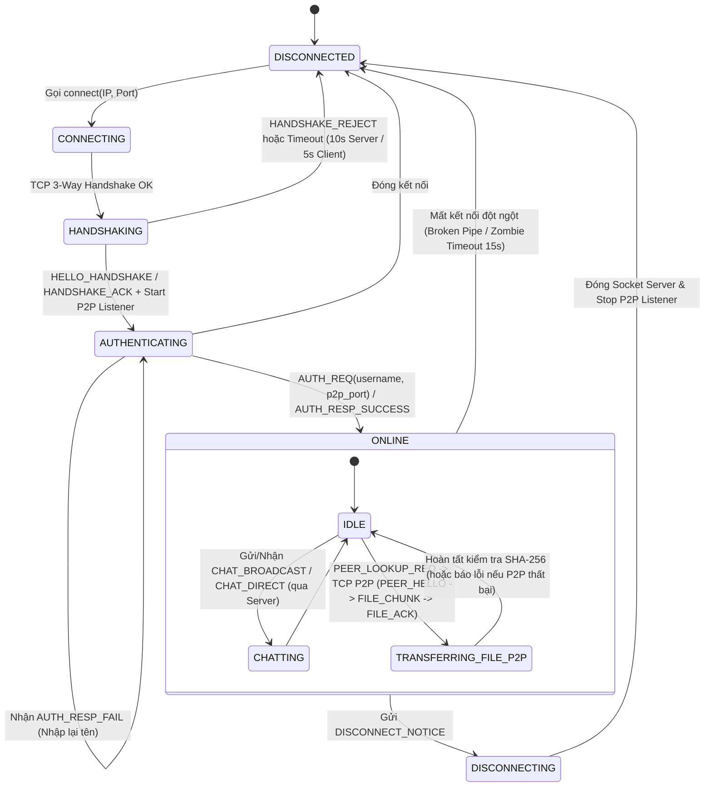

# TÀI LIỆU ĐẶC TẢ GIAO THỨC TẦNG ỨNG DỤNG (APPLICATION LAYER PROTOCOL SPECIFICATION)
> **Dự án:** Distributed Client-Server Collaboration Application  
> **Phiên bản Giao thức:** 1.0  
> **Giao vận tầng dưới:** TCP (Raw Socket)

---

## 1. TỔNG QUAN THIẾT KẾ GIAO THỨC

Trong mô hình mạng OSI/TCP-IP, tầng Transport (TCP) cung cấp dịch vụ truyền dữ liệu dạng **luồng byte liên tục (Stream-oriented)**, nghĩa là TCP không bảo toàn ranh giới giữa các thông điệp gửi đi. Nếu ứng dụng gửi hai thông điệp riêng biệt, bên nhận có thể:
1. Nhận cả hai thông điệp trong cùng một lần đọc socket (`Packet Concatenation / Dính gói`).
2. Chỉ nhận được một phần thông điệp trong một lần đọc (`Packet Fragmentation / Phân mảnh`).

Để giải quyết triệt để vấn đề này, hệ thống sử dụng phương pháp **Packet Framing có Header Độ Dài Cố Định (Fixed-Length Header with Length Prefix)** kết hợp với kiểm tra hợp lệ nhị phân qua **Magic Bytes**.

---

## 2. CẤU TRÚC GÓI TIN NHỊ PHÂN (PACKET BINARY FORMAT)

Mỗi gói tin truyền trên đường truyền bao gồm 2 phần liên tiếp:
1. **Binary Header (16 bytes cố định):** Chứa metadata và độ dài chính xác của Payload.
2. **Dynamic Payload (0 đến N bytes):** Dữ liệu thực tế của thông điệp (JSON, văn bản UTF-8 hoặc dữ liệu file nhị phân).

```text
 0                   1                   2                   3
 0 1 2 3 4 5 6 7 8 9 0 1 2 3 4 5 6 7 8 9 0 1 2 3 4 5 6 7 8 9 0 1
+-+-+-+-+-+-+-+-+-+-+-+-+-+-+-+-+-+-+-+-+-+-+-+-+-+-+-+-+-+-+-+-+
|       Magic Bytes ("CA")      |    Version    |               |
+-+-+-+-+-+-+-+-+-+-+-+-+-+-+-+-+-+-+-+-+-+-+-+-+               +
|         Message Type          |     Flags     |               |
+-+-+-+-+-+-+-+-+-+-+-+-+-+-+-+-+-+-+-+-+-+-+-+-+-+-+-+-+-+-+-+-+
|           Reserved            |                               |
+-+-+-+-+-+-+-+-+-+-+-+-+-+-+-+-+                               +
|                                                               |
+                     Payload Length (64-bit)                   +
|                                                               |
+-+-+-+-+-+-+-+-+-+-+-+-+-+-+-+-+-+-+-+-+-+-+-+-+-+-+-+-+-+-+-+-+
|                        Payload Data...                        |
|                     (Độ dài = Payload Length)                 |
+-+-+-+-+-+-+-+-+-+-+-+-+-+-+-+-+-+-+-+-+-+-+-+-+-+-+-+-+-+-+-+-+
```

### Chi tiết các trường trong Header (Network Byte Order - Big Endian `!`):

| Offset (Byte) | Tên trường | Kiểu dữ liệu | Kích thước | Mô tả chi tiết |
| :---: | :--- | :---: | :---: | :--- |
| **0 - 1** | `Magic Bytes` | `char[2]` (`2s`) | 2 bytes | Luôn là `b"CA"` (Collaboration App). Giúp bên nhận nhận diện ngay lập tức gói tin hợp lệ hay dữ liệu rác. |
| **2** | `Version` | `uint8` (`B`) | 1 byte | Phiên bản giao thức (hiện tại là `1`). Cho phép nâng cấp giao thức tương lai. |
| **3 - 4** | `Message Type` | `uint16` (`H`) | 2 bytes | Mã số xác định hành vi gói tin (xem bảng Message Types bên dưới). |
| **5** | `Flags` | `uint8` (`B`) | 1 byte | Các cờ bitmask: `0x01` (đã mã hóa AES), `0x02` (đã nén). |
| **6 - 7** | `Reserved` | `uint16` (`H`) | 2 bytes | Dự phòng mở rộng, hiện tại luôn đặt là `0x0000`. |
| **8 - 15** | `Payload Length` | `uint64` (`Q`) | 8 bytes | Độ dài chính xác của phần Payload theo sau tính bằng bytes (hỗ trợ truyền file tới hàng chục Gigabytes). |

**Định dạng chuỗi `struct` trong Python:** `"!2sBHBHQ"` (tổng cộng đúng 16 bytes).

---

## 3. DANH SÁCH MÃ THÔNG ĐIỆP (MESSAGE TYPES REGISTRY)

Các mã thông điệp được phân chia theo từng dải số chức năng (khớp chính xác với `common/message_types.py`):

| Nhóm | Mã (Code) | Tên Enum | Chiều truyền | Ý nghĩa & Dữ liệu Payload |
| :--- | :---: | :--- | :---: | :--- |
| **Handshake & Auth** | `101` | `HELLO_HANDSHAKE` | Client -> Server | Khởi tạo bắt tay ứng dụng: `{"client_name": "...", "client_version": 1}`. |
| | `102` | `HANDSHAKE_ACK` | Server -> Client | Đồng ý bắt tay, trả về `status="OK"`, `server_id`, `version`, `encryption_enabled`. |
| | `103` | `HANDSHAKE_REJECT` | Server -> Client | Từ chối kết nối do không tương thích phiên bản hoặc payload sai chuẩn. |
| | `104` | `AUTH_REQ` | Client -> Server | Yêu cầu đăng nhập: `{"username": "alice", "p2p_port": 51234}`. |
| | `105` | `AUTH_RESP_SUCCESS` | Server -> Client | Đăng nhập thành công: `{"status": "SUCCESS", "username": "alice", "online_users": [...], "peers": {...}}`. |
| | `106` | `AUTH_RESP_FAIL` | Server -> Client | Đăng nhập thất bại: `{"status": "FAIL", "reason": "..."}`. |
| **User Presence & Tracker** | `201` | `USER_LIST_REQ` | Client -> Server | Yêu cầu lấy danh sách người dùng đang online kèm danh bạ P2P. |
| | `202` | `USER_LIST_RESP` | Server -> Client | Trả về danh sách `users` và `peers` (`username`, `ip`, `p2p_port`). |
| | `203` | `USER_STATUS_BROADCAST` | Server -> Client | Thông báo có user `JOINED` hoặc `LEFT` kèm `online_users`, `peers` và `online_count`. |
| | `204` | `PEER_LOOKUP_REQ` | Client -> Server | Hỏi Tracker địa chỉ P2P: `{"username": "bob"}`. |
| | `205` | `PEER_LOOKUP_RESP` | Server -> Client | Tracker trả về `{"found": true, "username": "bob", "ip": "...", "p2p_port": ...}`. |
| **Chat Messaging** | `301` | `CHAT_BROADCAST` | Client <-> Server | Tin nhắn phòng chung (Server giữ thứ tự phát thanh): `{"sender", "content", "timestamp"}`. |
| | `302` | `CHAT_DIRECT` | Client <-> Server | Tin nhắn riêng 1-1 (`{"sender", "recipient", "content" | "e2ee"+"ciphertext", "timestamp"}`). |
| | `303` | `CHAT_ACK` | Server -> Client | Xác nhận đã chuyển tin nhắn (`{"status": "DELIVERED", "recipient", "timestamp"}`, không lặp bản rõ `content`). |
| **File Transfer (P2P Direct)** | `401` | `FILE_OFFER_REQ` | Peer -> Peer | Đề xuất gửi file trực tiếp (mã hóa bằng khóa phiên tạm X25519): `{"file_id", "sender", "recipient", "file_name", "file_size", "total_chunks", "sha256", "encrypted"}`. |
| | `402` | `FILE_OFFER_RESP` | Peer -> Peer | Chấp thuận (`ACCEPTED`) hoặc từ chối (`REJECTED`) nhận file (mã hóa khóa phiên X25519). |
| | `403` | `FILE_CHUNK` | Peer -> Peer | Mảnh dữ liệu file nhị phân (32 KB): Header JSON (`!I` + JSON) + Raw bytes (mã hóa toàn packet bằng khóa phiên X25519 tạm thời). |
| | `404` | `FILE_ACK` | Peer -> Peer | Xác nhận hoàn tất nhận file & kiểm tra SHA-256 (`SUCCESS` hoặc `FAILED`), xóa khóa phiên ngay sau khi đóng kênh. |
| | `405` | `PEER_HELLO` | Peer -> Peer | Bắt tay trực tiếp P2P (bọc bằng khóa chung AES): `{"sender", "protocol_version", "x25519_pub"}`. |
| | `406` | `PEER_HELLO_ACK` | Peer -> Peer | Peer phản hồi `OK`/`REJECTED` kèm `x25519_pub` để hai bên tự dẫn xuất khóa AES phiên tạm (HKDF-SHA256). |
| **Heartbeat** | `501` | `HEARTBEAT_PING` | Client -> Server | Gói tin nhịp tim kiểm tra liveness (chu kỳ 4.0s). |
| | `502` | `HEARTBEAT_PONG` | Server -> Client | Gói tin phản hồi nhịp tim (`{"status": "ALIVE"}`). |
| **Connection** | `601` | `DISCONNECT_NOTICE` | Client -> Server | Thông báo chủ động ngắt kết nối an toàn (Graceful Disconnect). |
| | `602` | `ERROR_NOTICE` | Server -> Client | Thông báo lỗi hệ thống hoặc vi phạm giao thức (ví dụ `FILE_P2P_ONLY`). |

---

## 4. SƠ ĐỒ MÁY TRẠNG THÁI CLIENT (CLIENT STATE MACHINE)



---

## 5. THUẬT TOÁN ĐỌC ĐỦ GÓI TIN (PACKET UNPACKING ALGORITHM)

```text
Function recv_packet(socket):
    1. header_bytes = recv_exact(socket, 16)
    2. (magic, version, msg_type, flags, reserved, payload_len) = unpack("!2sBHBHQ", header_bytes)
    3. If magic != "CA":
           Raise InvalidMagicBytesError
    4. If version != CURRENT_VERSION:
           Raise UnsupportedVersionError
    5. If payload_len > MAX_LIMIT (50MB):
           Raise PayloadTooLargeError
    6. payload_bytes = ""
    7. If payload_len > 0:
           payload_bytes = recv_exact(socket, payload_len)
    8. Return Packet(msg_type, payload_bytes, flags, version)
```
