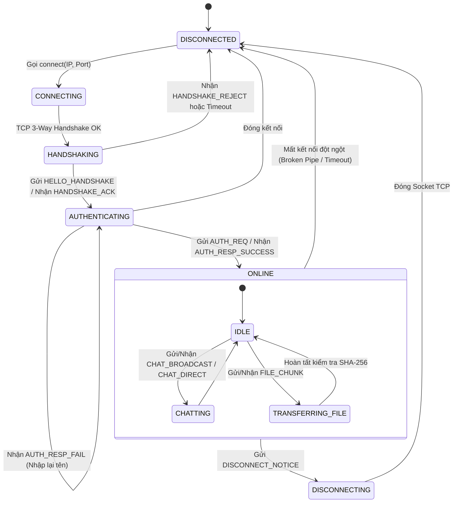

# TÀI LIỆU ĐẶC TẢ GIAO THỨC TẦNG ỨNG DỤNG (APPLICATION LAYER PROTOCOL SPECIFICATION)
> **Dự án:** Distributed Client-Server Collaboration Application  
> **Phiên bản Giao thức:** 1.0  
> **Giao vận tầng dưới:** TCP (Raw Socket)

---

## 1. TỔNG QUAN THIẾT KẾ GIAO THỨC

Trong mô hình mạng OSI/TCP-IP, tầng Transport (TCP) cung cấp dịch vụ truyền dữ liệu dạng **luồng byte liên tục (Stream-oriented)**, nghĩa là TCP không bảo toàn ranh giới giữa các thông điệp gửi đi. Nếu ứng dụng gửi hai thông điệp riêng biệt, bên nhận có thể:
1. Nhận cả hai thông điệp trong cùng một lần đọc socket (`Packet Concatenation / Dính gói`).
2. Chỉ nhận được một phần thông điệp trong một lần đọc (`Packet Fragmentation / Phân mảnh`).

Để giải quyết triệt để vấn đề này, hệ thống sử dụng phương pháp **Packet Framing có Header Độ Dài Cố Định (Fixed-Length Header with Length Prefix)** kết hợp với kiểm tra hợp lệ nhị phân qua **Magic Bytes**.

---

## 2. CẤU TRÚC GÓI TIN NHỊ PHÂN (PACKET BINARY FORMAT)

Mỗi gói tin truyền trên đường truyền bao gồm 2 phần liên tiếp:
1. **Binary Header (16 bytes cố định):** Chứa metadata và độ dài chính xác của Payload.
2. **Dynamic Payload (0 đến N bytes):** Dữ liệu thực tế của thông điệp (JSON, văn bản UTF-8 hoặc dữ liệu file nhị phân).

```text
 0                   1                   2                   3
 0 1 2 3 4 5 6 7 8 9 0 1 2 3 4 5 6 7 8 9 0 1 2 3 4 5 6 7 8 9 0 1
+-+-+-+-+-+-+-+-+-+-+-+-+-+-+-+-+-+-+-+-+-+-+-+-+-+-+-+-+-+-+-+-+
|       Magic Bytes ("CA")      |    Version    |               |
+-+-+-+-+-+-+-+-+-+-+-+-+-+-+-+-+-+-+-+-+-+-+-+-+               +
|         Message Type          |     Flags     |               |
+-+-+-+-+-+-+-+-+-+-+-+-+-+-+-+-+-+-+-+-+-+-+-+-+-+-+-+-+-+-+-+-+
|           Reserved            |                               |
+-+-+-+-+-+-+-+-+-+-+-+-+-+-+-+-+                               +
|                                                               |
+                     Payload Length (64-bit)                   +
|                                                               |
+-+-+-+-+-+-+-+-+-+-+-+-+-+-+-+-+-+-+-+-+-+-+-+-+-+-+-+-+-+-+-+-+
|                        Payload Data...                        |
|                     (Độ dài = Payload Length)                 |
+-+-+-+-+-+-+-+-+-+-+-+-+-+-+-+-+-+-+-+-+-+-+-+-+-+-+-+-+-+-+-+-+
```

### Chi tiết các trường trong Header (Network Byte Order - Big Endian `!`):

| Offset (Byte) | Tên trường | Kiểu dữ liệu | Kích thước | Mô tả chi tiết |
| :---: | :--- | :---: | :---: | :--- |
| **0 - 1** | `Magic Bytes` | `char[2]` (`2s`) | 2 bytes | Luôn là `b"CA"` (Collaboration App). Giúp bên nhận nhận diện ngay lập tức gói tin hợp lệ hay dữ liệu rác. |
| **2** | `Version` | `uint8` (`B`) | 1 byte | Phiên bản giao thức (hiện tại là `1`). Cho phép nâng cấp giao thức tương lai. |
| **3 - 4** | `Message Type` | `uint16` (`H`) | 2 bytes | Mã số xác định hành vi gói tin (xem bảng Message Types bên dưới). |
| **5** | `Flags` | `uint8` (`B`) | 1 byte | Các cờ bitmask: `0x01` (đã mã hóa AES), `0x02` (đã nén). |
| **6 - 7** | `Reserved` | `uint16` (`H`) | 2 bytes | Dự phòng mở rộng, hiện tại luôn đặt là `0x0000`. |
| **8 - 15** | `Payload Length` | `uint64` (`Q`) | 8 bytes | Độ dài chính xác của phần Payload theo sau tính bằng bytes (hỗ trợ truyền file tới hàng chục Gigabytes). |

**Định dạng chuỗi `struct` trong Python:** `"!2sBHBHQ"` (tổng cộng đúng 16 bytes).

---

## 3. DANH SÁCH MÃ THÔNG ĐIỆP (MESSAGE TYPES REGISTRY)

Các mã thông điệp được phân chia theo từng dải số chức năng:

| Nhóm | Mã (Code) | Tên Enum | Chiều truyền | Ý nghĩa & Dữ liệu Payload |
| :--- | :---: | :--- | :---: | :--- |
| **Handshake & Auth** | `101` | `HELLO_HANDSHAKE` | Client -> Server | Khởi tạo bắt tay ứng dụng, thông báo version client. |
| | `102` | `HANDSHAKE_ACK` | Server -> Client | Đồng ý bắt tay, trả về server id và banner chào mừng. |
| | `103` | `HANDSHAKE_REJECT` | Server -> Client | Từ chối kết nối do không tương thích phiên bản. |
| | `104` | `AUTH_REQ` | Client -> Server | Yêu cầu đăng nhập: `{"username": "alice"}`. |
| | `105` | `AUTH_RESP_SUCCESS` | Server -> Client | Đăng nhập thành công: `{"status": "ok", "user": "alice"}`. |
| | `106` | `AUTH_RESP_FAIL` | Server -> Client | Đăng nhập thất bại: `{"reason": "Tên đã tồn tại"}`. |
| **User Presence** | `201` | `USER_LIST_REQ` | Client -> Server | Yêu cầu lấy danh sách người dùng đang online. |
| | `202` | `USER_LIST_RESP` | Server -> Client | Trả về danh sách: `{"users": ["alice", "bob"]}`. |
| | `203` | `USER_STATUS_BROADCAST` | Server -> Client | Thông báo có user mới hoặc user rời mạng: `{"status": "JOINED", "username": "bob"}`. |
| **Chat Messaging** | `301` | `CHAT_BROADCAST` | Hai chiều | Tin nhắn gửi toàn phòng: `{"sender": "alice", "content": "Hello", "timestamp": 1710000000}`. |
| | `302` | `CHAT_DIRECT` | Hai chiều | Tin nhắn riêng tư 1-1: `{"sender": "alice", "recipient": "bob", "content": "Hi", "timestamp": ...}`. |
| | `303` | `CHAT_ACK` | Hai chiều | Xác nhận đã nhận tin nhắn: `{"msg_id": "...", "status": "DELIVERED"}`. |
| **File Transfer** | `401` | `FILE_OFFER_REQ` | Client -> Server | Đề xuất gửi file: `{"file_id": "...", "filename": "doc.pdf", "filesize": 10240, "sha256": "..."}`. |
| | `402` | `FILE_OFFER_RESP` | Server -> Client | Chấp thuận/từ chối nhận file: `{"file_id": "...", "action": "ACCEPT"}`. |
| | `403` | `FILE_CHUNK` | Hai chiều | Mảnh dữ liệu file nhị phân: Header JSON ngắn + Raw binary bytes. |
| | `404` | `FILE_ACK` | Hai chiều | Xác nhận đã nhận được mảnh file hoặc hoàn tất xác minh SHA-256. |
| **Heartbeat** | `501` | `HEARTBEAT_PING` | Hai chiều | Gói tin nhịp tim kiểm tra liveness: Payload rỗng hoặc timestamp. |
| | `502` | `HEARTBEAT_PONG` | Hai chiều | Gói tin phản hồi nhịp tim. |
| **Connection** | `601` | `DISCONNECT_NOTICE` | Hai chiều | Thông báo chủ động ngắt kết nối an toàn (Graceful Disconnect). |
| | `602` | `ERROR_NOTICE` | Server -> Client | Thông báo lỗi hệ thống hoặc vi phạm giao thức. |

---

## 4. SƠ ĐỒ MÁY TRẠNG THÁI CLIENT (CLIENT STATE MACHINE)



---

## 5. THUẬT TOÁN ĐỌC ĐỦ GÓI TIN (PACKET UNPACKING ALGORITHM)

```text
Function recv_packet(socket):
    1. header_bytes = recv_exact(socket, 16)
    2. (magic, version, msg_type, flags, reserved, payload_len) = unpack("!2sBHBHQ", header_bytes)
    3. If magic != "CA":
           Raise InvalidMagicBytesError
    4. If version != CURRENT_VERSION:
           Raise UnsupportedVersionError
    5. If payload_len > MAX_LIMIT (50MB):
           Raise PayloadTooLargeError
    6. payload_bytes = ""
    7. If payload_len > 0:
           payload_bytes = recv_exact(socket, payload_len)
    8. Return Packet(msg_type, payload_bytes, flags, version)
```
