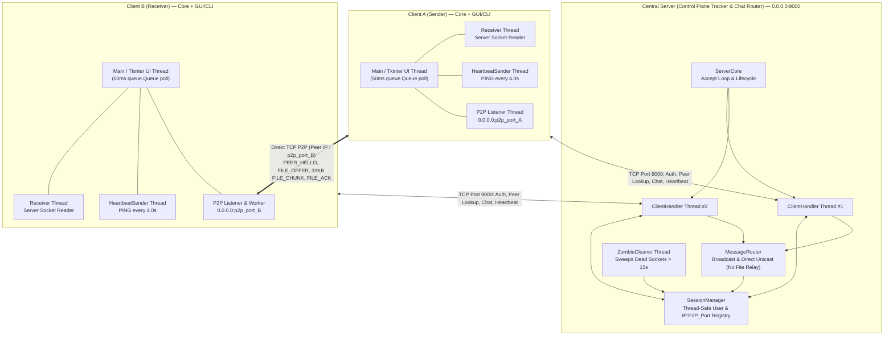
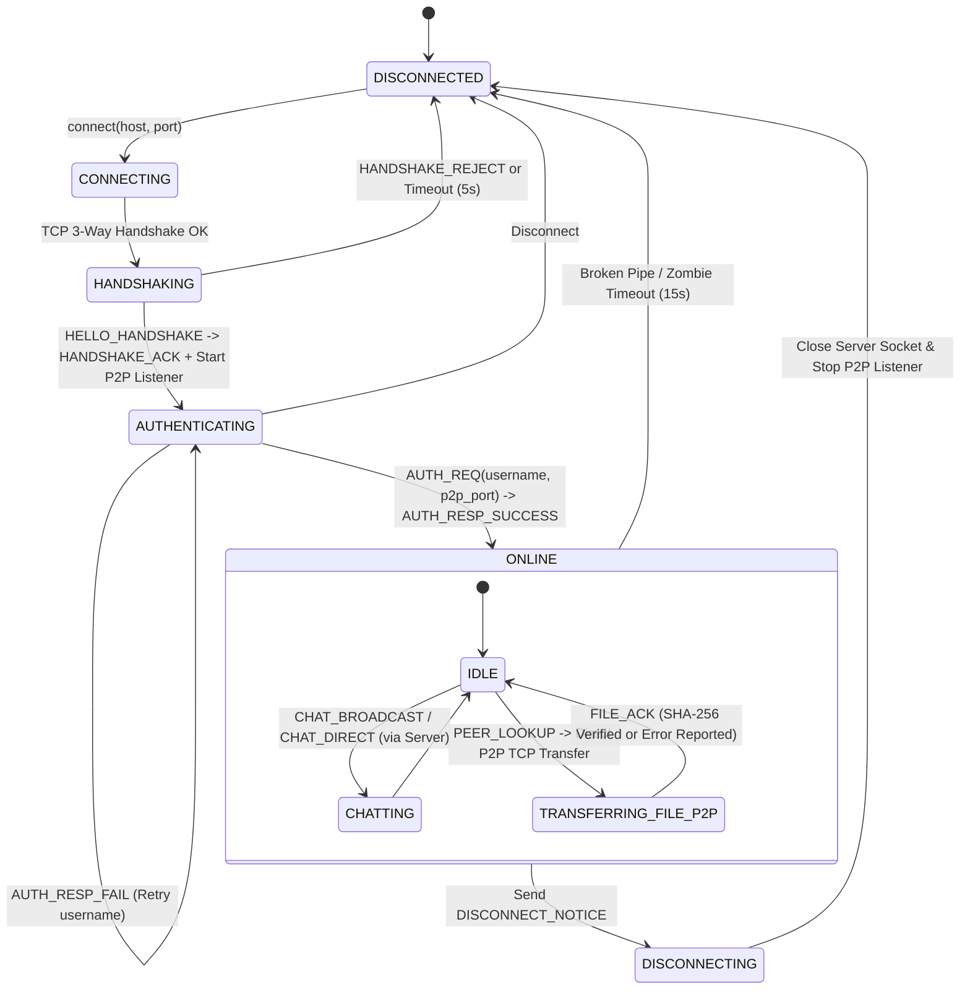
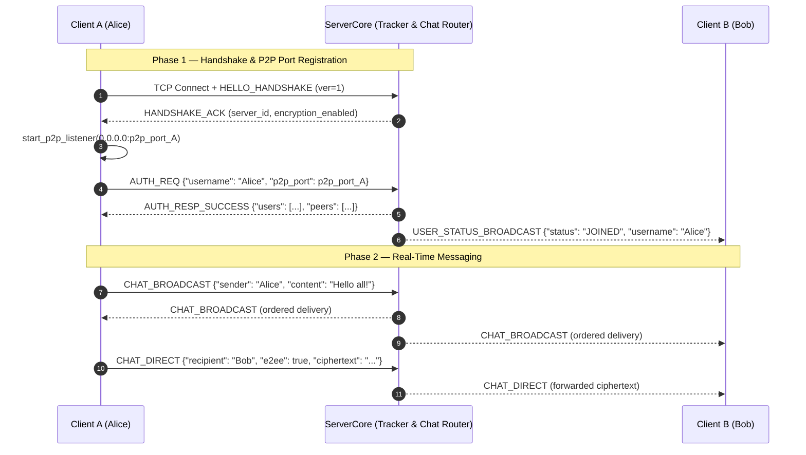
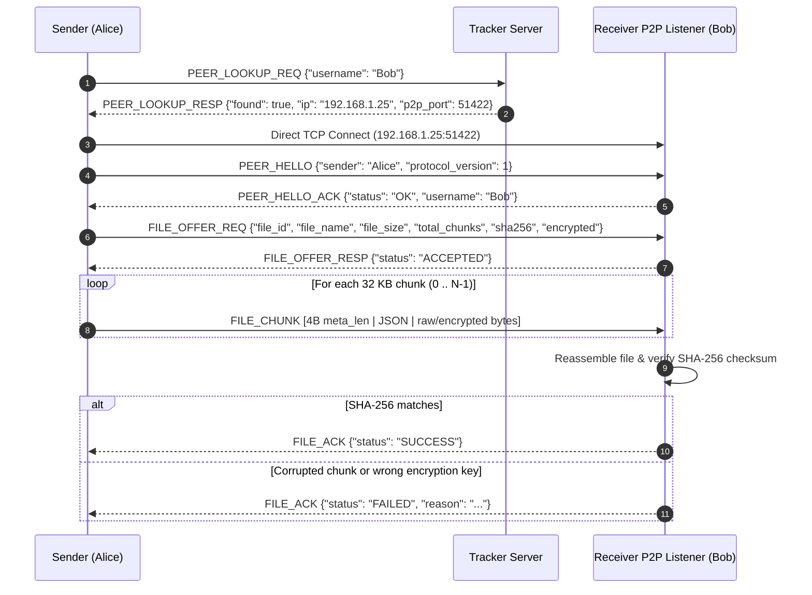
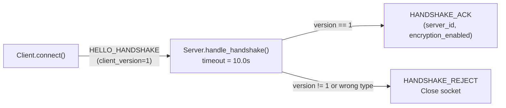
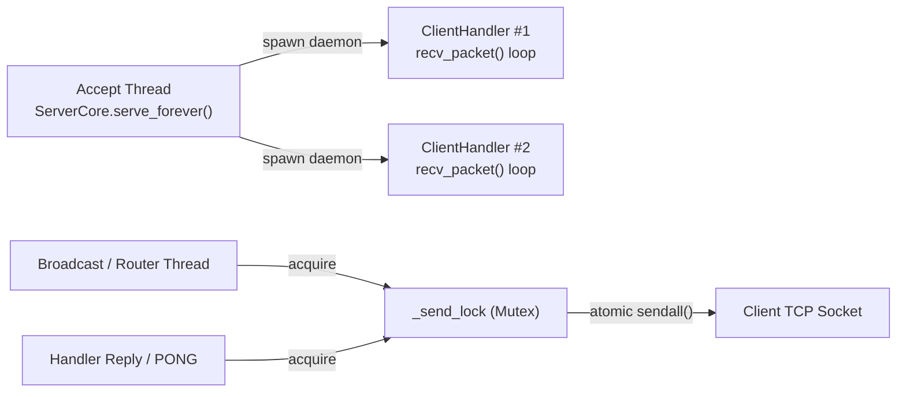
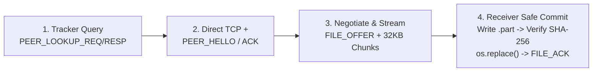
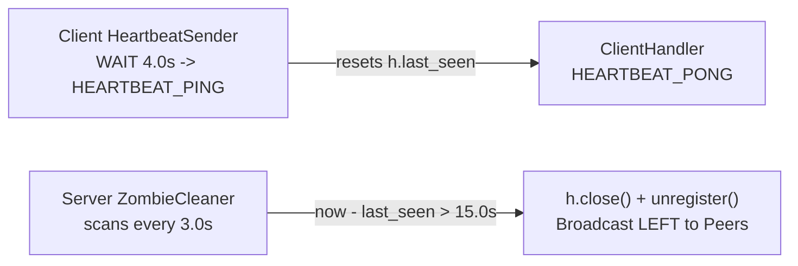
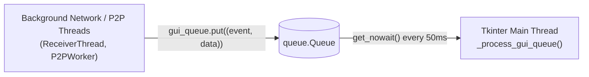

# Technical Report — Assignment 1: Distributed Client–Server Collaboration Application

> **Course:** Network Application Development  
> **Project Title:** Distributed Client–Server Collaboration Application (Hybrid Client–Server + Direct P2P File Transfer)  
> **Student Name(s) / Team:** `[Student Name(s) / Team]`  
> **Student ID(s):** `[Student ID(s)]`  
> **Instructor:** `[Instructor Name]`  
> **Submission Date:** `[Submission Date]` *(Assignment Reference Deadline: Sunday, November 17, 2026)*  
> **Repository:** <https://github.com/QuanNguyenCS/DISTRIBUTED-CLIENT-SERVER-COLLABORATION-APPLICATION>  
> **Verified CI Run:** GitHub Actions `#43700487784` (`ubuntu-latest`, `windows-latest`, `macos-latest` — Passing)

---

## Table of Contents
1. [Introduction & Project Context](#1-introduction--project-context)
2. [Features & Technical Requirements](#2-features--technical-requirements)
3. [Hybrid System Architecture](#3-hybrid-system-architecture)
4. [Application-Layer Protocol Specification](#4-application-layer-protocol-specification)
5. [Project Structure & 10-Step Implementation Breakdown](#5-project-structure--10-step-implementation-breakdown)
6. [Engineering Challenges & Solutions](#6-engineering-challenges--solutions)
7. [Testing, Stress Benchmarks & Cross-Platform CI](#7-testing-stress-benchmarks--cross-platform-ci)
8. [Installation & Running Guide](#8-installation--running-guide)
9. [Conclusion](#9-conclusion)

---

## 1. Introduction & Project Context

### 1.1 Background & Motivation
In modern team environments—such as university labs, office networks, and engineering workspaces—users on the same Local Area Network (LAN) frequently need to exchange messages and share files reliably without relying on cloud servers or heavy web frameworks. Building such a system directly on top of **operating-system sockets** teaches core networking concepts: stream framing, concurrency, state tracking, failure detection, and encryption.

### 1.2 Problem Statement
Raw TCP sockets behave as a **continuous stream of bytes**, not discrete messages. Without a custom framing protocol, rapid sends cause **packet concatenation** (two messages read together) or **packet fragmentation** (one message split across reads). In addition, a naive single-threaded server blocks when one slow client stalls, while relaying large binary files through a central server creates unnecessary memory, CPU, and bandwidth bottlenecks.

### 1.3 Project Goal
Our goal is to design and build a complete, cross-platform collaboration application from scratch using Python's low-level `socket` module (without HTTP frameworks, WebSockets, or RPC libraries). The system supports **10–20+ concurrent clients**, provides both a **Tkinter GUI** and a **CLI**, encrypts payloads on demand, recovers cleanly from dropped connections, and transfers files **directly peer-to-peer (P2P)** with SHA-256 integrity checks.

### 1.4 Target Users
- Small engineering or classroom teams collaborating over a shared LAN or localhost.
- Students and instructors evaluating raw-socket protocol engineering across Windows, macOS, and Linux.

---

## 2. Features & Technical Requirements

### 2.1 Core Features Implemented
1. **Application Handshake & Version Checking:** Validates protocol magic bytes (`b"CA"`) and version (`1`) before any session begins.
2. **User Authentication & Live Presence:** Enforces unique, regex-validated usernames (`^[a-zA-Z0-9_\-]{3,20}$`), maintains an online user directory with peer P2P endpoints, and broadcasts `JOINED`/`LEFT` updates.
3. **Real-Time Text Messaging:** Supports ordered **Broadcast** messages to the shared room and **Direct 1-on-1 (Unicast)** messages, all automatically encrypted using the shared `COLLAB_AES_KEY`.
4. **Reliable Direct P2P File Transfer:** Uses the server strictly as a Tracker (`PEER_LOOKUP_REQ` / `PEER_LOOKUP_RESP`) to discover the receiver's `(IP, P2P_Port)`, then streams 32 KB file chunks over a direct peer-to-peer TCP connection and verifies **SHA-256** integrity. Server-side file relaying is explicitly disabled (`FILE_P2P_ONLY`).
5. **Network Resilience & Fault Tolerance:** Runs periodic client heartbeats (`4.0s`) and a server background `ZombieCleaner` (`15.0s` timeout) to reap half-open or dead sockets automatically.
6. **Encryption Layer:** Derives a cryptographic key using **PBKDF2-HMAC-SHA256** (`100,000` iterations) and secures payloads with **Fernet** (`AES-128-CBC + HMAC-SHA256`).
7. **Dual Interfaces (GUI & CLI):** Provides a non-blocking Tkinter tabbed interface (with live file progress dialog) and a feature-complete terminal client.

### 2.2 Compliance with Technical Constraints
| Constraint | Requirement in Assignment | Implementation in This Project | Status |
| :--- | :--- | :--- | :---: |
| **Low-level Transport** | Raw TCP/UDP sockets only; no Flask, Django, FastAPI, WebSockets, or RPC | Built solely on Python `socket` (`AF_INET`, `SOCK_STREAM`) and `struct` | Compliant |
| **Custom Protocol** | Custom framing, header, payload, message codes, state machine | 16-byte fixed header (`!2sBHBHQ`) + 24 `MessageType` codes (`101..602`) | Compliant |
| **Concurrency** | Handle 10–20 concurrent clients without blocking | Multi-threaded server (`ClientHandler` per client) + thread-safe locks | Compliant |
| **Cross-Platform** | Run cleanly on Windows, macOS, and Linux | Tested on Windows 11, WSL2 Ubuntu, and GitHub Actions 3-OS matrix | Compliant |

---

## 3. Hybrid System Architecture

### 3.1 Why Hybrid Client–Server + Direct P2P?
A pure client–server design works well for **lightweight control messages** and **ordered room chat**, because every client keeps one stable TCP socket to the server and sees broadcast messages in a single consistent order. However, routing large file transfers through that same server wastes central bandwidth.

Conversely, a pure serverless P2P design makes username uniqueness, room-wide message ordering, and presence tracking difficult on dynamic LANs. Therefore, we separate responsibilities cleanly:

- **Control Plane & Messaging -> Central Server (`ServerCore`):**
  - Application handshake (`HELLO_HANDSHAKE` / `HANDSHAKE_ACK`)
  - Authentication & P2P endpoint registration (`AUTH_REQ`, `p2p_port`)
  - Live presence & peer directory (`USER_LIST_*`, `USER_STATUS_BROADCAST`, `PEER_LOOKUP_*`)
  - Ordered room broadcast (`CHAT_BROADCAST`) and 1-on-1 message routing (`CHAT_DIRECT`)
  - Heartbeat monitoring & zombie socket cleanup (`HEARTBEAT_PING/PONG`, `ZombieCleaner`)
- **Bulk File Transfer -> Direct P2P TCP (`ClientCore` P2P Listener & Workers):**
  - Each client binds a local P2P TCP listener (`0.0.0.0:p2p_port`, OS-assigned when `0`) before logging in.
  - To send a file, the sender asks the Tracker for the receiver's `(ip, p2p_port)`, opens a direct TCP socket to that peer, completes `PEER_HELLO` / `PEER_HELLO_ACK`, sends `FILE_OFFER_REQ`, streams 32 KB `FILE_CHUNK` packets, and waits for a direct `FILE_ACK`.
  - If a client tries to send `FILE_*` packets through the central server, the server rejects them with `ERROR_NOTICE (code="FILE_P2P_ONLY")`.

### 3.2 High-Level Architecture Diagram



### 3.3 Threading & Concurrency Model
| Component | Thread Role | Synchronization Mechanism | Responsibility |
| :--- | :--- | :--- | :--- |
| **Server** | Main / Accept Thread | `ServerCore._running` flag | Accepts incoming TCP connections (`backlog=20`) and spawns `ClientHandler`. |
| **Server** | `ClientHandler` (1 per client) | `SessionManager._lock`, per-handler `_send_lock` | Runs handshake (`10.0s` timeout), decodes packets, dispatches chat & tracker lookups. |
| **Server** | `ZombieCleaner` (daemon) | `SessionManager._lock` | Runs every `3.0s`; disconnects sessions silent for more than `15.0s`. |
| **Client** | Main / Tkinter UI Thread | `queue.Queue` + `self.after(50, ...)` | Renders widgets, captures user actions, polls network events every 50 ms. |
| **Client** | `ReceiverThread` (daemon) | `_send_lock`, `_auth_event`, `_lookup_events` | Reads Server packets continuously without blocking UI or CLI input. |
| **Client** | `HeartbeatSender` (daemon) | `threading.Event.wait(4.0)` | Sends `HEARTBEAT_PING` every `4.0s` while connected. |
| **Client** | `P2PListener` & Workers (daemons) | `_p2p_workers_lock`, `_incoming_files_lock` | Accepts direct incoming peer TCP connections (`30.0s` socket timeout) and receives chunks. |

---

## 4. Application-Layer Protocol Specification

### 4.1 Packet Framing Design (16-Byte Fixed Binary Header)
To prevent TCP stream concatenation and fragmentation, every message sent over either the Server TCP socket or a Direct P2P TCP socket is wrapped inside a binary frame defined in `common/protocol.py`:

```text
 0                   1                   2                   3
 0 1 2 3 4 5 6 7 8 9 0 1 2 3 4 5 6 7 8 9 0 1 2 3 4 5 6 7 8 9 0 1
+-+-+-+-+-+-+-+-+-+-+-+-+-+-+-+-+-+-+-+-+-+-+-+-+-+-+-+-+-+-+-+-+
|       Magic Bytes ("CA")      |  Version (1)  |  MsgType (H)  |
+-+-+-+-+-+-+-+-+-+-+-+-+-+-+-+-+-+-+-+-+-+-+-+-+-+-+-+-+-+-+-+-+
| MsgType cont. |   Flags (B)   |         Reserved (H)          |
+-+-+-+-+-+-+-+-+-+-+-+-+-+-+-+-+-+-+-+-+-+-+-+-+-+-+-+-+-+-+-+-+
|                                                               |
+                     Payload Length (uint64)                   +
|                                                               |
+-+-+-+-+-+-+-+-+-+-+-+-+-+-+-+-+-+-+-+-+-+-+-+-+-+-+-+-+-+-+-+-+
|                        Payload Data (0..N bytes)              |
|            (JSON UTF-8, raw binary, or Fernet ciphertext)     |
+-+-+-+-+-+-+-+-+-+-+-+-+-+-+-+-+-+-+-+-+-+-+-+-+-+-+-+-+-+-+-+-+
```

*Exact Python `struct` format string:* `"!2sBHBHQ"` (Network Byte Order / Big Endian, **16 bytes total**).

| Byte Offset | Field Name | Format | Size | Value & Purpose |
| :---: | :--- | :---: | :---: | :--- |
| `0 - 1` | **Magic Bytes** | `2s` | 2 B | Always `b"CA"` (`MAGIC_BYTES`). Immediately rejects invalid/corrupt traffic. |
| `2` | **Version** | `B` | 1 B | Currently `1` (`PROTOCOL_VERSION`). Enables forward compatibility checks. |
| `3 - 4` | **Message Type** | `H` | 2 B | Unsigned 16-bit integer mapped to `MessageType` (`101..602`). |
| `5` | **Flags** | `B` | 1 B | Bitmask: `0x00` (`FLAG_NONE`), `0x01` (`FLAG_ENCRYPTED`), `0x02` (`FLAG_COMPRESSED`). |
| `6 - 7` | **Reserved** | `H` | 2 B | Reserved for future headers; always `0`. |
| `8 - 15` | **Payload Length** | `Q` | 8 B | Exact byte length of payload (`MAX_PAYLOAD_SIZE = 50 * 1024 * 1024`, i.e., 50 MB). |

### 4.2 Message Type Registry (`common/message_types.py`)

| Category | Code | Enum Name | Channel & Direction | Payload Purpose |
| :--- | :---: | :--- | :--- | :--- |
| **Handshake & Auth** | `101` | `HELLO_HANDSHAKE` | Client -> Server | Sends `client_version` (`1`) and `client_name`. |
| | `102` | `HANDSHAKE_ACK` | Server -> Client | Confirms compatibility, returns `status="OK"`, `server_id`, `version`, `encryption_enabled`. |
| | `103` | `HANDSHAKE_REJECT` | Server -> Client | Rejects incompatible protocol version. |
| | `104` | `AUTH_REQ` | Client -> Server | Registers `{"username": "...", "p2p_port": <int>}`. |
| | `105` | `AUTH_RESP_SUCCESS` | Server -> Client | Confirms login; returns `online_users` and peer directory `peers`. |
| | `106` | `AUTH_RESP_FAIL` | Server -> Client | Rejects duplicate or invalid username with `reason`. |
| **Presence & Tracker** | `201` | `USER_LIST_REQ` | Client -> Server | Requests current active users and P2P directory. |
| | `202` | `USER_LIST_RESP` | Server -> Client | Returns list of usernames and `peers` (`username`, `ip`, `p2p_port`). |
| | `203` | `USER_STATUS_BROADCAST` | Server -> Client | Pushes `JOINED` / `LEFT` events with `p2p_ip` and `p2p_port`. |
| | `204` | `PEER_LOOKUP_REQ` | Client -> Server | Queries Tracker for target user's `{"username": "..."}`. |
| | `205` | `PEER_LOOKUP_RESP` | Server -> Client | Returns `{"found": true/false, "ip": "...", "p2p_port": <int>}`. |
| **Chat Routing** | `301` | `CHAT_BROADCAST` | Client <-> Server | Sends or relays room-wide chat text (`sender`, `content`, `timestamp`). |
| | `302` | `CHAT_DIRECT` | Client <-> Server | Routes 1-on-1 message (`sender`, `recipient`, encrypted on wire via `COLLAB_AES_KEY`). |
| | `303` | `CHAT_ACK` | Bidirectional | Optional message delivery acknowledgment. |
| **P2P File Transfer** | `401` | `FILE_OFFER_REQ` | Peer -> Peer | Proposes file (`file_id`, `file_name`, `file_size`, `total_chunks`, `sha256`, `encrypted`). |
| | `402` | `FILE_OFFER_RESP` | Peer -> Peer | Returns `ACCEPTED` or `REJECTED`. |
| | `403` | `FILE_CHUNK` | Peer -> Peer | Transfers 4-byte metadata len (`!I`) + JSON metadata + up to 32 KB raw bytes. |
| | `404` | `FILE_ACK` | Peer -> Peer | Reports final SHA-256 verification status (`SUCCESS` or `FAILED`). |
| | `405` | `PEER_HELLO` | Peer -> Peer | Initiates direct P2P handshake (`sender`, `protocol_version`). |
| | `406` | `PEER_HELLO_ACK` | Peer -> Peer | Confirms (`OK`) or rejects (`REJECTED`) direct P2P transfer session. |
| **Heartbeat** | `501` | `HEARTBEAT_PING` | Bidirectional | Keepalive check (sent every `4.0s` by client). |
| | `502` | `HEARTBEAT_PONG` | Bidirectional | Liveness response (`{"status": "ALIVE"}`). |
| **Connection** | `601` | `DISCONNECT_NOTICE` | Bidirectional | Signals graceful shutdown prior to closing socket. |
| | `602` | `ERROR_NOTICE` | Server -> Client | Reports protocol errors (e.g., `FILE_P2P_ONLY`, `E2EE_ROUTING_REQUIRED`). |

### 4.3 Client Finite State Machine



### 4.4 Protocol Sequence Diagrams

#### Sequence A: Connection, Authentication, Tracker Discovery & Chat Messaging



#### Sequence B: Direct Peer-to-Peer File Transfer (Zero Server Relay)



---

## 5. Project Structure & 10-Step Implementation Breakdown

### 5.0 Project Folder Tree & Module Responsibilities
Before walking through the 10 development steps, the repository layout below summarizes the role of every package and file in the system:

```text
DISTRIBUTED-CLIENT-SERVER-COLLABORATION-APPLICATION/
├── run_server.py                 # Server CLI entrypoint (binds 0.0.0.0:9000, auto AES encryption)
├── run_client.py                 # Interactive Terminal CLI client (/msg, @user, /file, /ping, /quit)
├── run_gui.py                    # Desktop GUI launcher initializing CollabChatApp
├── requirements.txt              # Minimal external dependencies: cryptography & pytest
├── README.md                     # Project overview, feature list, architecture summary, and run commands
├── DEVELOPMENT_PLAN.md           # Original 10-step implementation roadmap and checklist
│
├── .github/
│   └── workflows/
│       └── ci.yml                # GitHub Actions CI matrix testing Ubuntu (xvfb), Windows, and macOS
│
├── common/                       # Shared transport, protocol, security, and logging primitives
│   ├── __init__.py               # Package marker exposing common helpers
│   ├── protocol.py               # 16B binary framing (!2sBHBHQ), Packet dataclass, recv_exact/recv_packet, DoS cap
│   ├── message_types.py          # MessageType(IntEnum) registry defining 24 protocol opcodes (101..602)
│   ├── crypto_utils.py           # PBKDF2-HMAC-SHA256 (100k iter) key derivation & Fernet encrypt/decrypt
│   └── logger.py                 # Cross-platform UTF-8 safe structured logging utility
│
├── server/                       # Central Control Plane Tracker & Ordered Chat Router
│   ├── __init__.py               # Server package marker
│   ├── server_core.py            # TCP accept loop, application handshake, broadcast helper, ZombieCleaner
│   ├── client_handler.py         # Per-client daemon thread, packet dispatch, _send_lock, FILE_P2P_ONLY guard
│   ├── session_manager.py        # Thread-safe active user registry, regex check, effective LAN IP & p2p_port store
│   └── router.py                 # MessageRouter for ordered CHAT_BROADCAST and 1-on-1 CHAT_DIRECT delivery
│
├── client/                       # Client Engine, P2P File Transfer, Keepalive & Supporting UI
│   ├── __init__.py               # Client package marker
│   ├── client_core.py            # State management, server receiver thread, tracker lookup, P2P listener & workers
│   ├── file_transfer.py          # 32 KB chunk slicing, binary FILE_CHUNK pack/unpack, .part + SHA-256 verification
│   ├── heartbeat.py              # Background HeartbeatSender thread emitting HEARTBEAT_PING every 4.0s
│   └── gui/                      # Thin Tkinter presentation layer decoupled via queue.Queue
│       ├── __init__.py           # GUI package marker
│       ├── app.py                # Main Tk controller polling gui_queue every 50ms on the UI main thread
│       ├── login_view.py         # Server IP/Port, Username, and optional Passphrase connection panel
│       ├── chat_view.py          # Shared room tab, per-user private tabs, online list & file picker
│       └── file_progress.py      # Non-blocking progress bar & transfer speed window for P2P file transfers
│
├── storage/                      # Local runtime folders created/used during execution
│   ├── client_downloads/         # Default download directory for verified P2P received files
│   └── server_cache/             # Reserved server storage folder (unused for files in pure P2P mode)
│
├── docs/                         # Protocol and academic documentation
│   ├── protocol_specs.md         # Detailed wire format & state transition reference
│   ├── technical_report.md       # This English technical report
│   └── main.tex                  # Standalone LaTeX version with native TikZ diagrams
│
└── tests/                        # Automated Pytest verification suite (76 tests + stress benchmark)
    ├── __init__.py               # Test package marker
    ├── test_protocol.py          # 12 tests: 16B header, 1B fragmentation, EOF mid-payload, >50MB & version guards
    ├── test_handshake.py         # 9 tests: HELLO acceptance, non-dict JSON DoS guard, RLock port bind, worker handshake
    ├── test_concurrency.py       # 6 tests: auth gate, concurrent logins/exits & 6-client Barrier burst
    ├── test_auth.py              # 8 tests: username rules, duplicate reject, 5-thread Barrier race condition, P2P port
    ├── test_router.py            # 5 tests: room broadcast, 1-on-1 routing, case-insensitive user, offline & self guards
    ├── test_file_transfer.py     # 12 tests: P2P stream, O(1) .part cleanup, non-overwrite, path traversal, concurrent P2P
    ├── test_resilience.py        # 4 tests: heartbeat liveness, 15s zombie + LEFT list sync, drop cleanup & queue cap
    ├── test_crypto.py            # 12 tests: auto COLLAB_AES_KEY, anti-downgrade, ephemeral P2P X25519 secrecy
    ├── test_gui.py               # 7 tests: Tkinter views, safe logout & gui_queue Producer–Consumer dispatching
    └── stress_test.py            # 15–20 client automated load test checking >=98% delivery ratio (also standalone)
```

Every stage below directly maps to the 10-step assignment rubric (`1.0 pt` per step), combining architecture explanations, cross-references to the diagrams and tables in **Section 3** and **Section 4**, and real code excerpts from the repository.

---

### Step 1: Setup & Protocol Design (`common/protocol.py`, `common/message_types.py`)
Raw TCP sockets only transmit an unstructured stream of bytes. Without explicit boundaries, two adjacent JSON payloads merge into one `recv()` buffer (*packet concatenation*), or one large message arrives split across multiple `recv()` calls (*packet fragmentation*).

As illustrated in the **16-Byte Binary Header Diagram (Section 4.1)** and **MessageType Registry Table (Section 4.2)**, we wrap every message in a fixed 16-byte Big-Endian binary header (`!2sBHBHQ`) followed by `payload_len` bytes, and classify all 24 protocol operations into numeric ranges (`100`–`699`):

```python
# common/protocol.py — 16B header definition & safe framing reader
MAGIC_BYTES, PROTOCOL_VERSION = b"CA", 1
HEADER_FORMAT = "!2sBHBHQ"                  # 16 bytes (Network Byte Order)
MAX_PAYLOAD_SIZE = 50 * 1024 * 1024         # 50 MB upper bound against OOM/DoS

def recv_packet(sock: socket.socket, decrypt_key: Optional[bytes] = None) -> Packet:
    header_bytes = recv_exact(sock, HEADER_SIZE)
    magic, version, raw_msg_type, flags, _res, payload_len = struct.unpack(HEADER_FORMAT, header_bytes)
    if magic != MAGIC_BYTES:           raise InvalidMagicBytesError(...)
    if version != PROTOCOL_VERSION:    raise UnsupportedVersionError(...)
    if payload_len > MAX_PAYLOAD_SIZE: raise PayloadTooLargeError(...)
    payload_bytes = recv_exact(sock, payload_len) if payload_len > 0 else b""
```

```python
# common/message_types.py — Sample opcodes grouped by function (101..602)
class MessageType(IntEnum):
    HELLO_HANDSHAKE = 101; HANDSHAKE_ACK = 102; AUTH_REQ = 104
    USER_LIST_REQ = 201;   USER_STATUS_BROADCAST = 203; PEER_LOOKUP_REQ = 204
    CHAT_BROADCAST = 301;  CHAT_DIRECT = 302;   CHAT_ACK = 303
    FILE_OFFER_REQ = 401;  FILE_CHUNK = 403;    FILE_ACK = 404; PEER_HELLO = 405
    HEARTBEAT_PING = 501;  HEARTBEAT_PONG = 502; DISCONNECT_NOTICE = 601; ERROR_NOTICE = 602
```

Notice the engineering boundary guard in `recv_packet()`: inspecting `magic`, `version`, and `payload_len <= MAX_PAYLOAD_SIZE` *before* allocating the payload buffer prevents malformed traffic from crashing the server. *(Why `MAX_PAYLOAD_SIZE` is `50 MB` while file chunks are `32 KB` is straightforward: `50 MB` is a wire-level OOM ceiling on the 64-bit length header, whereas chunking keeps per-transfer RAM usage constant at $O(1)$.)*

---

### Step 2: Basic Client–Server Handshake (`client/client_core.py`, `server/server_core.py`)
Right after the OS completes the TCP 3-way handshake, both endpoints validate compatibility before entering the `AUTHENTICATING` state (see **Section 4.3 FSM** and **Sequence A, Phase 1 in Section 4.4**). The server sets a strict `10.0s` handshake timeout so idle half-connected sockets cannot tie up the accept flow:



```python
# client/client_core.py — Client sends HELLO_HANDSHAKE right after TCP connect
hello_payload = {"client_name": self.client_name, "client_version": protocol_version}
self.sock.sendall(create_packet(MessageType.HELLO_HANDSHAKE, hello_payload, version=protocol_version))
response = recv_packet(self.sock)
if response.msg_type == MessageType.HANDSHAKE_ACK:
    self.server_info = response.to_json()
    return True
```

```python
# server/server_core.py — Server validates protocol version within 10.0s timeout
if client_version != PROTOCOL_VERSION:
    client_sock.sendall(create_packet(MessageType.HANDSHAKE_REJECT, {"status": "REJECT"}))
    return False, None
client_sock.sendall(create_packet(MessageType.HANDSHAKE_ACK, {
    "status": "OK", "server_id": self.server_id, "encryption_enabled": self.crypto_key is not None,
}))
```

---

### Step 3: Concurrency Implementation (`server/server_core.py`, `server/client_handler.py`)
To serve 10–20+ clients smoothly without head-of-line blocking (see **Section 3.2 Architecture Diagram** & **Section 3.3 Threading Table**), `ServerCore` uses a **Thread-per-Client** architecture. Once handshake succeeds, `serve_forever()` immediately delegates the socket to a daemon `ClientHandler` thread. Because multiple threads (such as a room broadcast, direct message delivery, and a heartbeat `PONG`) can write to the *same* client socket concurrently, every `ClientHandler` guards `sendall()` with a dedicated `_send_lock` so packet bytes never interleave:



```python
# server/server_core.py — Accept loop spawns a daemon ClientHandler per connection
client_sock, client_addr = self.server_sock.accept()
success, client_info = self.handle_handshake(client_sock, client_addr)
if success:
    handler = ClientHandler(client_sock, client_addr, server=self, client_info=client_info)
    self.register_handler(handler)
    handler.start()

# server/client_handler.py — Per-socket mutex prevents concurrent byte interleaving
with self._send_lock:
    if self.client_sock:
        self.client_sock.sendall(packet_bytes)
```

---

### Step 4: Authentication & State Management (`server/session_manager.py`, `client/client_core.py`)
Before logging in, the client starts its local P2P TCP listener (`start_p2p_listener()`) and declares `p2p_port` inside `AUTH_REQ` (see `MessageType 104` in **Section 4.2**). Inside `SessionManager`, a mutex (`self._lock`) ensures atomic check-and-insert so two simultaneous clients racing for the same username cannot overwrite each other. The server automatically records the socket-observed LAN IP as `UserSession.effective_ip` so Tracker lookups work across separate physical machines instead of returning an unreachable `127.0.0.1`:

```python
# server/session_manager.py — Regex & Mutex-guarded P2P session registration
USERNAME_REGEX = re.compile(r"^[a-zA-Z0-9_\-]{3,20}$")
key = username.strip().lower()
with self._lock:
    if key in self._sessions:
        return False, f"Username '{clean_username}' đã có người sử dụng...", None
    self._sessions[key] = UserSession(
        username=clean_username, handler=handler, address=address, p2p_port=valid_p2p_port
    )
```

Upon success, the server returns `AUTH_RESP_SUCCESS` containing the live peer directory and pushes `USER_STATUS_BROADCAST (event="JOINED")` to all other clients.

---

### Step 5: Real-Time Text Routing (`server/router.py`, `client/client_core.py`)
`MessageRouter` handles both shared room broadcasts (`CHAT_BROADCAST`) and private 1-on-1 messages (`CHAT_DIRECT`), as depicted in **Sequence A (Phase 2) in Section 4.4**. Broadcast packets iterate over an active handler snapshot (`only_authenticated=True`) to deliver consistent ordering across the room, while `route_direct_message()` rejects self-messaging (`SELF_MESSAGE_NOT_ALLOWED`), looks up the recipient case-insensitively, notifies the sender if offline (`USER_NOT_FOUND`), and replies with minimal metadata `CHAT_ACK` (never echoing plaintext `content` on the wire):

```python
# server/router.py — Self-send check, direct lookup & secret-free CHAT_ACK
if sender_username.strip().lower() == recipient_username.strip().lower():
    sender_handler.send_packet(MessageType.ERROR_NOTICE, {"code": "SELF_MESSAGE_NOT_ALLOWED"})
    return False, reason
session = self.server.session_mgr.get_session(recipient_username)
if session and session.handler:
    session.handler.send_packet(MessageType.CHAT_DIRECT, direct_payload)
    sender_handler.send_packet(MessageType.CHAT_ACK, {"status": "DELIVERED", "recipient": session.username, "timestamp": ts})
```

---

### Step 6: Reliable Direct P2P File Transfer (`client/file_transfer.py`, `client/client_core.py`, `server/client_handler.py`)
As shown in **Section 3.2 (Red P2P Link)** and **Sequence B (Section 4.4)**, bulk file bytes **never traverse the central server**. Instead, transferring a file executes a strict four-stage direct P2P pipeline:



To keep RAM usage bounded regardless of file size, `pack_chunk_payload()` packs a compact `[4B !I metadata_len | JSON | <=32 KB raw bytes]` frame. On the receiving side, `IncomingFileTransfer.assemble_and_verify()` writes chunks to a `.part` staging file first and deletes it automatically if the final SHA-256 checksum fails:

```python
# client/file_transfer.py — Atomic .part assembly & SHA-256 verification
DEFAULT_CHUNK_SIZE: int = 32 * 1024
temp_part_path = f"{self.save_path}.{self.file_id}.part"
try:
    with open(temp_part_path, "wb") as f:
        for i in range(self.total_chunks):
            f.write(self.received_chunks[i])
    if calculate_file_hash(temp_part_path).lower() != self.expected_sha256.lower():
        raise ValueError("Mã băm SHA-256 không trùng khớp!")
    os.replace(temp_part_path, self.save_path)
except ValueError as err:
    if os.path.exists(temp_part_path): os.remove(temp_part_path)
    return False, str(err)
```

Meanwhile, `ClientHandler` explicitly blocks any attempt to relay file packets (`401..404`) through the server:

```python
# server/client_handler.py — Explicit server relay rejection
elif msg_type in (MessageType.FILE_OFFER_REQ, MessageType.FILE_OFFER_RESP, MessageType.FILE_CHUNK, MessageType.FILE_ACK):
    self.send_packet(MessageType.ERROR_NOTICE, {"code": "FILE_P2P_ONLY", "message": "..."})
```

---

### Step 7: Network Resilience & Error Handling (`client/heartbeat.py`, `server/server_core.py`)
When a laptop loses Wi-Fi or a client crashes without sending `DISCONNECT_NOTICE`, TCP sockets can stay open half-dead ("zombie sockets"), blocking usernames in `SessionManager`. Our keepalive loop solves this deterministically (see **Section 4.3 FSM**):



```python
# client/heartbeat.py (lines 45-60) — Periodic 4.0s PING probe
if self._stop_event.wait(timeout=self.interval):
    break
    self.client.send_packet(MessageType.HEARTBEAT_PING, {
        "client": self.client.username or self.client.client_name, "timestamp": time.time(),
    })

# server/server_core.py (lines 390-405) — Zombie sweep every 3.0s
for h in self.get_all_handlers():
    if now - h.last_seen > self.zombie_timeout:  # > 15.0s idle
        h.close()
```

---

### Step 8: Security Layer (`common/crypto_utils.py`, `server/client_handler.py`, `client/client_core.py`)
Traffic protection is **automatic and zero-config**—users do not enter any room password:
1. **Shared System AES Key (`COLLAB_AES_KEY`):** Both `ServerCore` and `ClientCore` load `get_shared_app_key()` at startup (reading env var `COLLAB_AES_KEY` or falling back to `DEFAULT_SHARED_SECRET`), automatically encrypting `AUTH`, `User List`, `Tracker Lookup`, `CHAT_*`, `CHAT_ACK`, and `PEER_HELLO/ACK` with **Fernet** (`AES-128-CBC + HMAC-SHA256`), setting `FLAG_ENCRYPTED = 0x01`. Unencrypted downgrade attempts are rejected with `ENCRYPTION_REQUIRED`, and mismatched keys fail with `DECRYPTION_FAILED`.
2. **Ephemeral P2P X25519 Forward Secrecy:** For each P2P file transfer, peers exchange ephemeral `X25519` public keys inside `PEER_HELLO` $\leftrightarrow$ `PEER_HELLO_ACK` (zero extra round-trips), derive a one-time AES session key via `HKDF-SHA256`, encrypt `FILE_OFFER_*`, `FILE_CHUNK`, and `FILE_ACK`, and erase the key in `finally:` upon completion:

```python
# common/crypto_utils.py — Ephemeral X25519 + HKDF-SHA256 P2P session key
shared_secret = private_key.exchange(peer_pub)
derived = HKDF(algorithm=hashes.SHA256(), length=32, salt=None, info=_P2P_HKDF_INFO).derive(shared_secret)
return base64.urlsafe_b64encode(derived)

# server/client_handler.py — Reject mismatched or missing AES tokens cleanly
if packet.is_encrypted and self.server.crypto_key is not None:
    try:
        packet = packet.get_decrypted_packet(self.server.crypto_key)
    except InvalidToken:
        self.send_packet(MessageType.ERROR_NOTICE, {"code": "DECRYPTION_FAILED", "message": "..."})
        continue
```

---

### Step 9: Supporting UI & CLI Integration (`client/gui/app.py`, `run_client.py`)
From a distributed systems perspective, the Tkinter UI (`client/gui/`) and CLI (`run_client.py`) are **thin presentation wrappers** built atop the single shared `ClientCore` engine. The critical engineering concern at this boundary is **thread safety**: calling Tkinter widget methods directly from `ReceiverThread` or a `P2PWorker` causes freezes or cross-thread GUI crashes. We solve this using a lock-free **Producer–Consumer `queue.Queue`** bridge polled every `50 ms` on the main GUI thread:



```python
# Excerpt from client/gui/app.py (lines 172-186 & 210-222)
def on_broadcast(pkt: Packet):
    self.gui_queue.put(("chat_broadcast", _safe_json(pkt)))

def on_direct(pkt: Packet):
    self.gui_queue.put(("chat_direct", _safe_json(pkt)))

def _process_gui_queue(self) -> None:
    try:
        while True:
            event_type, data = self.gui_queue.get_nowait()
            self._dispatch_gui_event(event_type, data)
    except queue.Empty:
        pass
    finally:
        self.after(50, self._process_gui_queue)
```

---

### Step 10: Automated Testing, Stress Verification & Code Quality (`tests/`, `.github/workflows/ci.yml`)
Beyond happy-path checks, our **76 Pytest tests** rigorously target edge-case failures: non-dict JSON `HELLO` payloads, occupied-port deadlocks, slow handshake isolation, auth gates, automatic `COLLAB_AES_KEY` & anti-downgrade (`ENCRYPTION_REQUIRED`), ephemeral X25519 P2P forward secrecy, 1-byte TCP fragmentation, `> 50 MB` headers, `threading.Barrier` race conditions, O(1) `.part` SHA-256 cleanup, non-overwriting downloads, path traversal, zombie departure snapshots, and a $\ge 98\%$ delivery stress harness. Every commit is verified across **Ubuntu, Windows, and macOS** via `.github/workflows/ci.yml`:

```python
# tests/test_auth.py (lines 250-264) — Simultaneous Barrier login race test
def racer(idx: int):
    barrier.wait(timeout=3.0)
    ok, _ = clients[idx].authenticate("RaceWinner", timeout=3.0)
    outcomes[idx] = ok
# Asserts strictly 1 winner and 4 rejections:
assert outcomes.count(True) == 1 and outcomes.count(False) == num_racers - 1
```

```yaml
# .github/workflows/ci.yml — 3-OS automated Pytest matrix
matrix:
  os: [ubuntu-latest, windows-latest, macos-latest]
run: xvfb-run -a pytest -v   # (or pytest -v on Windows / macOS)
```

---

## 6. Engineering Challenges & Solutions

*(Concise 1-page reflection on the hardest distributed systems issues resolved during development.)*

1. **TCP Stream Concatenation & Partial Reads**
   - *Challenge:* Sending back-to-back JSON messages or `FILE_CHUNK` streams caused `socket.recv()` to merge two packets or truncate mid-payload, breaking JSON decoding.
   - *Solution:* Replaced naive `recv(4096)` calls with the 16-byte fixed binary header (`!2sBHBHQ`) and deterministic `recv_exact(sock, n)` loops that validate `b"CA"` magic bytes, protocol version, and payload upper bounds (`50 MB`). Tested explicitly under 1-byte fragmentation and concatenated bursts in `tests/test_protocol.py`.

2. **Tkinter UI Freezes & Cross-Thread Exceptions**
   - *Challenge:* Invoking `Text.insert()` or opening file progress bars directly from the `ReceiverThread` or `P2PWorker` threads caused Tkinter runtime crashes and UI freezes on Windows and Linux.
   - *Solution:* Enforced strict single-thread UI ownership in `client/gui/app.py`. Network threads only call `self.gui_queue.put((event, data))`, while the Tkinter main loop polls `queue.get_nowait()` every `50 ms` using `self.after(...)`.

3. **Half-Open ("Zombie") Sockets After Unplugged Cables or Process Kills**
   - *Challenge:* When a client terminates abruptly without closing its TCP socket cleanly, TCP alone may take minutes to detect the dead peer, leaving stale usernames locked in `SessionManager`.
   - *Solution:* Combined a 4.0-second client `HeartbeatSender` (`HEARTBEAT_PING`) with a server `ZombieCleaner` background thread scanning every 3.0s (`zombie_timeout = 15.0s`). Stale sessions are closed, evicted, and broadcast as `LEFT` automatically (verified in `tests/test_resilience.py`).

4. **Server Bottleneck vs. Peer Discovery in Direct P2P File Transfer**
   - *Challenge:* Initially, routing 32 KB file chunks through `MessageRouter` burdened the server with every file transfer. Switching to P2P introduced two new pitfalls: (a) how to find a peer's ephemeral port, and (b) clients accidentally registering `127.0.0.1` instead of their real LAN IP.
   - *Solution:* Kept the server as a lightweight Tracker (`PEER_LOOKUP_REQ` -> `PEER_LOOKUP_RESP`) storing each client's `effective_ip` (derived by the server from the incoming TCP socket peer address) and client-supplied `p2p_port`. Removed fallback server relaying entirely (`FILE_P2P_ONLY`) so file failures fail loudly and clearly without hiding broken LAN/firewall configurations.

5. **Cross-Platform Behavior & Headless Linux GUI Testing**
   - *Challenge:* Emoji/UTF-8 console output on Windows triggered `cp1252` encoding errors, while headless Ubuntu runners lack an X display for Tkinter GUI tests (`tests/test_gui.py`).
   - *Solution:* Standardized `PYTHONUTF8="1"` across runs and CI, used OS-independent `pathlib` / `os.path.basename` path sanitization, and configured GitHub Actions (`.github/workflows/ci.yml`) to execute `xvfb-run -a pytest -v` on `ubuntu-latest` alongside `windows-latest` and `macos-latest`.

---

## 7. Testing, Stress Benchmarks & Cross-Platform CI

### 7.1 Automated Pytest Suite (76 Tests)
| Test Module | Count | Verified Behavior |
| :--- | :---: | :--- |
| `tests/test_protocol.py` | 12 | 16-byte header packing, magic/version/oversized rejection, 1B fragmentation, mid-payload close, concatenated packets |
| `tests/test_handshake.py` | 9 | Valid handshake, version mismatch, non-dict JSON DoS guard, `RLock` bind, non-blocking slow handshake |
| `tests/test_concurrency.py` | 6 | Auth gate (`AUTH_REQUIRED`), concurrent logins/disconnects, simultaneous Barrier burst without interleaving |
| `tests/test_auth.py` | 8 | Login success, duplicate rejection, 5-thread race (`Barrier`), regex rules, live `online_users`/`peers` sync |
| `tests/test_router.py` | 5 | Room broadcast, private 1-on-1 routing, case-insensitive recipient, `CHAT_ACK` metadata without plaintext leak |
| `tests/test_file_transfer.py` | 12 | Direct P2P transfer, O(1) `.part` streaming + SHA-256 cleanup, non-overwrite, index bounds, path traversal, `FILE_P2P_ONLY` |
| `tests/test_resilience.py` | 4 | Heartbeat keepalive, graceful disconnect, zombie eviction + `LEFT` list sync, abrupt drop reset & queue cap |
| `tests/test_crypto.py` | 12 | Auto `COLLAB_AES_KEY` & env override, anti-downgrade `ENCRYPTION_REQUIRED`, ephemeral X25519 P2P forward secrecy |
| `tests/test_gui.py` | 7 | Login validation, auto `online_users` sync, safe logout state reset, `gui_queue` dispatching, progress dialog |
| `tests/stress_test.py` | 1 | 15-client automated concurrency & $\ge 98\%$ delivery rate stress harness (also runnable standalone) |
| **Total** | **76** | **76 Passed / 0 Failed / 0 Skipped** |

### 7.2 Observed Multi-Environment Test Results
- **Windows 11 Local (`.\venv\Scripts\pytest -v`):** **76 passed** (0 failed, 0 skipped).
- **WSL2 Ubuntu Linux (`xvfb-run -a pytest -v`):** **All tests passed** (0 failed, 0 skipped).
- **GitHub Actions CI (Python 3.12):**
  - `Pytest on ubuntu-latest (Python 3.12)` -> `completed (success)`
  - `Pytest on windows-latest (Python 3.12)` -> `completed (success)`
  - `Pytest on macos-latest (Python 3.12)` -> `completed (success)`

### 7.3 Concurrent Stress Test Benchmark (16 Clients)
Command executed: `python tests/stress_test.py --clients 16 --duration 5.0`
- **Clients Connected & Authenticated:** **16 / 16** in **0.07 seconds**
- **Active Stress Duration:** **5.23 seconds**
- **Total Messages Sent:** **482 messages** (**92.2 messages/sec**)
- **Total Deliveries Received:** **5,282 deliveries** (broadcast fan-out across peers)
- **Socket Errors / Resource Leaks:** **0**

---

## 8. Installation & Running Guide

### 8.1 Prerequisites & Environment Setup (Windows, macOS, Linux)
Requires **Python 3.10+** (tested on Python 3.12). On Linux desktops/servers running GUI tests, ensure Tkinter/Xvfb packages are installed (`sudo apt-get install -y python3-tk libtk8.6 xvfb`).

```bash
# 1. Clone repository
git clone https://github.com/QuanNguyenCS/DISTRIBUTED-CLIENT-SERVER-COLLABORATION-APPLICATION.git
cd DISTRIBUTED-CLIENT-SERVER-COLLABORATION-APPLICATION

# 2. Create and activate virtual environment
python -m venv venv
# Windows PowerShell:
.\venv\Scripts\activate
# macOS / Linux:
source venv/bin/activate

# 3. Install dependencies (cryptography, pytest)
pip install -r requirements.txt
```

### 8.2 Running the Server
```bash
# Default server on 0.0.0.0:9000 (automatic AES encryption active via COLLAB_AES_KEY / built-in default)
python run_server.py --host 0.0.0.0 --port 9000
```

### 8.3 Running Clients (GUI or CLI)
**Option A — Desktop GUI (`Tkinter`):**
```bash
python run_gui.py
```
Enter Server IP (`127.0.0.1` locally or the Server's LAN IP like `192.168.1.10`), Port (`9000`), Username, and optional Passphrase. Double-click any user in the online list to open a 1-on-1 chat tab, or click **Send File** to transmit via Direct P2P.

**Option B — Terminal CLI:**
```bash
python run_client.py --host 127.0.0.1 --port 9000 --username Bob --p2p-port 0
```
| CLI Command | Action |
| :--- | :--- |
| `<message text>` | Send broadcast message to the shared room |
| `@<user> <text>` or `/msg <user> <text>` | Send private 1-on-1 direct message |
| `/file <user> <path>` or `/sendfile <user> <path>` | Send file directly P2P with SHA-256 check |
| `/users` or `/who` | Display online users |
| `/ping` | Send manual `HEARTBEAT_PING` |
| `/quit` or `/exit` | Send `DISCONNECT_NOTICE` and close cleanly |

### 8.4 Running on a Multi-Machine LAN
- All machines must sit on the same LAN subnet (or VPN).
- Clients on another PC **must** connect using the Server's real LAN IP (not `127.0.0.1`).
- Allow TCP traffic on the Server port (`9000`) and each Client's P2P listener port (specify fixed ports via `--p2p-port 51001` in CLI if configuring strict firewall rules).

### 8.5 Running Tests & Stress Benchmark
```bash
# Full automated suite (Linux headless needs: xvfb-run -a pytest -v)
pytest -v

# 16-client stress benchmark
python tests/stress_test.py --clients 16 --duration 5.0
```

---

## 9. Conclusion
This project delivers a clean, well-tested, cross-platform distributed collaboration system built directly over raw TCP sockets. By keeping authentication, presence tracking, and ordered chat on a multi-threaded central server while offloading file streams onto direct peer-to-peer sockets protected by PBKDF2-derived Fernet encryption and SHA-256 verification, the application avoids central file bottlenecks without sacrificing chat ordering or state consistency. All 76 tests pass reliably across Windows, Linux, and macOS.
