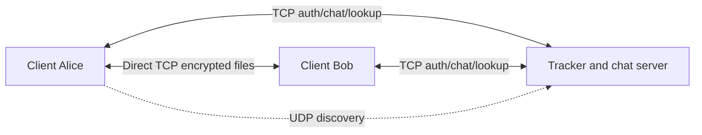
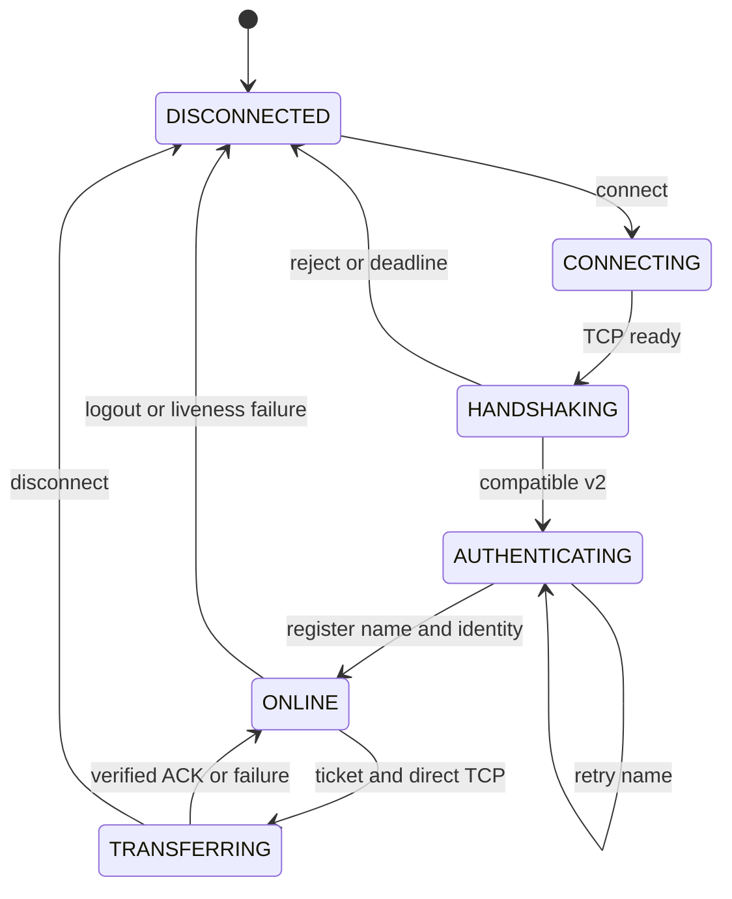
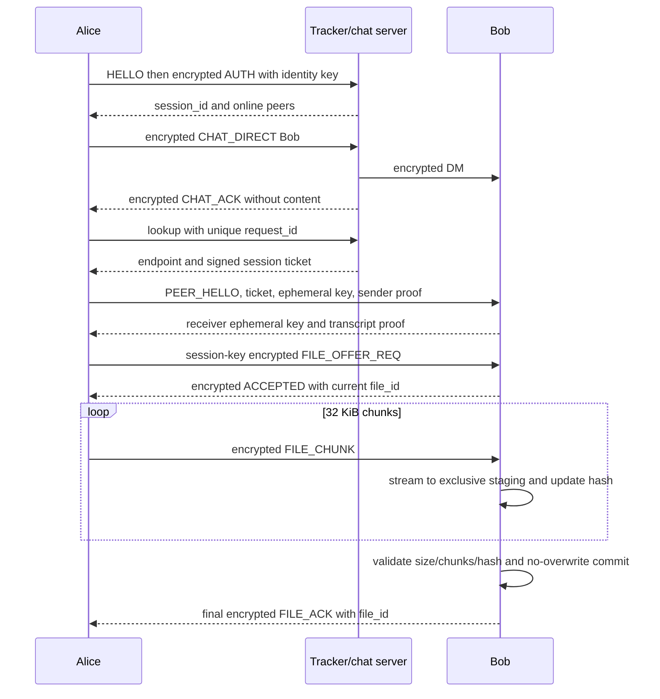

# Technical report — collaboration application v2

## Architecture and scope

Python socket APIs implement the application without HTTP frameworks or WebSockets. TCP carries central control/chat and direct P2P files. UDP provides authenticated LAN server discovery; heartbeat remains TCP.

The listener hands central handshakes to bounded workers. Each established handler reads independently and writes through a bounded outbound queue. A shared lock orders broadcast enqueue operations across recipients; slow socket writes occur on separate writer threads. Queue overflow or send timeout closes the affected connection. This provides a consistent accepted broadcast order, not guaranteed delivery to disconnected recipients.

SessionManager locks unique-name registration and endpoint lookup. The tracker stores observed TCP source IP, connection port, advertised P2P port, identity public key and session ID. P2P workers/listeners and GUI workers are separated from the Tk main thread. The server never relays file contents.

## Protocol and state

The 16-byte header is `!2sBHBHQ`: CA magic, version 2, message type, flags, reserved zero, wire payload length. Encrypted plaintext starts with an authenticated copy of version/type/flags. The receiver compares this context before parsing the application payload, preventing private ciphertext being reclassified as broadcast. Compression is not implemented; unknown flags/reserved fields are rejected. [Full specification](protocol_specs.md) defines registry and payload schemas.

Central HELLO has a 64 KiB cap and 10-second monotonic total deadline. Control/P2P receive paths use 64 KiB caps and bounded packet deadlines. The generic parser retains a 50 MiB cap; this is not the normal allowance for accepted control frames.

## Keys, authentication and trust

Normal entrypoints require a private COLLAB_AES_KEY distributed outside the source repository. Missing configuration fails clearly; the old source-code secret is removed. Keys may be Fernet keys or passphrases derived with PBKDF2HMAC-SHA256, 100,000 iterations. Fernet uses AES-128-CBC and HMAC-SHA256; its combined key is not an AES-256 cipher key.

The auth gate rejects data before login. Protected auth/list/lookup/chat requests must be encrypted. Names are temporary online identities, not persistent password-protected accounts. Successful auth returns a fresh session ID and presence snapshots.

Each peer registers an Ed25519 identity key during auth. The tracker signs a 30-second ticket containing both names, session IDs and public identity keys. The sender signs its ticket and ephemeral X25519 public key. The receiver checks authorization/replay and signs the full response transcript using its own identity key. The sender verifies that proof before using the X25519/HKDF-SHA256 session key. A room member cannot claim another active session merely by repeating its username.

The room key remains a group trust boundary. This is not a PKI and does not defend against a room-key holder actively impersonating the central server. It cannot prevent a legitimate recipient lying about future file retention. Dropping Python key references is not guaranteed secure RAM zeroization.

## Message and file sequences

File IDs are full UUID hex values. Tracker request IDs are separate, so simultaneous lookups of one recipient cannot overwrite each other's waiter. Metadata types, recipient/sender, indices/counts/lengths, total bytes and SHA-256 are checked. An empty file uses one empty chunk. There is one final application ACK, not per-chunk ACKs. TCP handles byte retransmission; no resume or relay fallback is provided.

The receiver exclusively creates an unpredictable staging file. Failure/interruption removes only its owned staging data. A hard-link commit reserves a final name without replacing existing data, even when another process commits concurrently. Filesystems lacking hard-link support fail safely. Memory does not grow with the whole file; framing/crypto buffers and worker count still consume resources.

Each file and aggregate announced incoming data are limited to 2 GiB per client. There are at most eight receiving P2P workers and sixteen tracked P2P sockets. Central active connections and pending handshakes are bounded. These limits are not a guarantee of arbitrary-scale resource isolation.

## Resilience and UI

The client probes every four seconds; server cleanup normally removes sessions silent for over 15 seconds plus the three-second sweep interval. Liveness duration uses monotonic time. The client detects missing server heartbeat responses as well. Shutdown detaches sockets, wakes blocked I/O with shutdown/close, and waits for P2P workers within a total budget. Captured socket references avoid the previous None.shutdown race.

Tkinter consumes a bounded event queue with bounded work each tick. Generation tags reject stale events from previous login sessions. Upload workers capture their client/session; downloads and completion use file IDs. Both directions have cancellation that reaches the transfer socket. Visible history is bounded to 5,000 lines per tab. This does not imply unlimited tabs or a general UI performance guarantee.

## Engineering challenges and solutions

1. **TCP streaming:** exact reads plus fixed headers reconstruct message boundaries; total deadlines limit incomplete frames.
2. **Authenticated meaning:** payload encryption alone left routing type mutable. Version 2 authenticates and checks header context.
3. **Peer identity:** tracker tickets and signed transcripts bind live session identities and ephemeral keys instead of trusting self-asserted names.
4. **Filesystem races:** exclusive staging and no-overwrite final commit preserve existing files across threads/processes.
5. **Concurrency/lifecycle:** correlation IDs isolate waiters; socket registries and cancellation align cleanup with the correct transfer; generation tags isolate GUI sessions.

## Validation and limitations

Install requirements-dev.txt and run `python -m pytest -q`. Existing protocol/auth/router/resilience/file/GUI tests remain; changed expectations reflect intentional v2 security behavior. New regression tests cover mutable headers, forged peers/ACKs, ticket replay/expiry/session binding, concurrent transfers, cross-process commits, cancellation, bounded workers/queues, missing PONG and UDP loopback discovery. [Fix mapping](review_fixes.md) records observed validation results.

Local Windows tests do not prove that Linux/macOS CI has passed. Inspect actual CI jobs, then separately verify LAN topology/firewalls, prolonged load and target filesystem behavior. The source report can be typeset from main.tex; an earlier external submission PDF is not silently rewritten.
